# UML

---

## 📄 본문

### UML이란?

UML(Unified Modeling Language)은 **소프트웨어 시스템의 구조와 동작을 시각적으로 표현하기 위한 표준 모델링 언어**이다.

시스템의 구성 요소와 관계, 객체 간 상호작용 등을 다이어그램으로 표현하여 설계 내용을 이해하고 공유하는 데 사용한다.

UML은 특정 개발 도구나 프로그래밍 언어가 아닌 모델링 표준이며, PlantUML과 Mermaid 등을 이용해 일부 UML 다이어그램을 작성할 수 있다.

### UML 다이어그램 종류

UML 다이어그램은 크게 구조 다이어그램과 행위 다이어그램으로 구분한다.

|구분|다이어그램|용도|
|---|---|---|
|구조|클래스 다이어그램|클래스의 속성, 메서드, 관계|
|구조|컴포넌트 다이어그램|시스템 구성 요소와 의존 관계|
|구조|배포 다이어그램|서버와 배포 환경의 구성|
|행위|유스케이스 다이어그램|사용자와 시스템의 기능 관계|
|행위|활동 다이어그램|업무 처리 흐름과 분기|
|행위|상태 머신 다이어그램|객체의 상태와 상태 전이|
|행위|시퀀스 다이어그램|객체 간 메시지 호출 순서|

백엔드 개발에서는 클래스, 시퀀스, 상태 머신, 컴포넌트, 배포 다이어그램 등을 활용할 수 있다.

### UML 작성 도구

|도구|특징|추천 용도|
|---|---|---|
|PlantUML|텍스트 기반 UML 작성 도구|시퀀스, 클래스, 상태 다이어그램|
|Mermaid|마크다운 친화적인 다이어그램 도구|흐름도, 간트차트, 간단한 시퀀스|
|diagrams.net(draw.io)|GUI 기반 다이어그램 편집 도구|아키텍처, 배포 구조|
|Lucidchart|협업 중심 시각적 설계 도구|팀 설계 및 공유|
|Figma/FigJam|UI 설계 및 협업 화이트보드|화면 흐름, 사용자 여정|

개인 개발 및 Git 기반 문서 관리에서는 PlantUML과 Mermaid를 우선 활용하기 좋다.

### PlantUML

PlantUML은 텍스트 문법으로 UML 및 다양한 다이어그램을 생성하는 오픈소스 도구이다.

코드를 이용해 다이어그램을 작성하기 때문에 Git으로 변경 이력을 관리하거나 문서와 함께 유지보수하기 편리하다.

#### 기본 문법
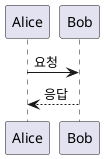

```
@startuml

Alice -> Bob : 요청
Bob --> Alice : 응답

@enduml
```

- `@startuml`: 다이어그램 시작
    
- `@enduml`: 다이어그램 종료
    
- `->`: 실선 메시지
    
- `-->`: 점선 메시지
    
- `:`: 메시지 내용 구분
    

독립적인 `.puml` 파일에서는 일반적으로 시작 및 종료 선언을 사용한다.

#### 참가자 선언
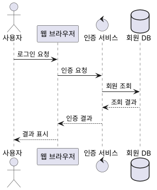

```
@startuml

actor 사용자 as User
participant "웹 브라우저" as Browser
control "인증 서비스" as Auth
database "회원 DB" as DB

User -> Browser : 로그인 요청
Browser -> Auth : 인증 요청
Auth -> DB : 회원 조회
DB --> Auth : 조회 결과
Auth --> Browser : 인증 결과
Browser --> User : 결과 표시

@enduml
```

|키워드|의미|
|---|---|
|`actor`|사용자 또는 외부 행위자|
|`participant`|일반적인 참여 객체|
|`boundary`|시스템 외부와의 접점|
|`control`|처리를 제어하는 객체|
|`entity`|도메인 객체|
|`database`|데이터베이스|
|`queue`|메시지 큐|
|`as`|별칭 지정|

### 시퀀스 다이어그램(Sequence Diagram)

시퀀스 다이어그램은 객체 또는 시스템 구성 요소 사이에서 메시지가 어떤 순서로 전달되는지 시간의 흐름에 따라 표현하는 UML 다이어그램이다.

API 호출, 인증 과정, 데이터 저장, 외부 서비스 연동과 같은 처리 흐름을 설명하는 데 사용한다.

#### 구성 요소

|구성 요소|설명|
|---|---|
|Actor|시스템과 상호작용하는 사용자|
|Participant|메시지를 주고받는 객체|
|Lifeline|객체의 존재를 나타내는 세로선|
|Activation|객체가 작업을 수행하는 구간|
|Message|객체 간 호출 또는 전달|
|Return Message|호출에 대한 응답|
|Combined Fragment|조건, 반복, 병렬 처리 등의 구간|

#### 메시지 문법
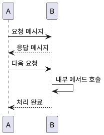

```
@startuml

participant A
participant B

A -> B : 요청 메시지
B --> A : 응답 메시지

A -> B : 다음 요청
B -> B : 내부 메서드 호출
B --> A : 처리 완료

@enduml
```

일반적으로 실선은 요청이나 호출, 점선은 반환 메시지를 표현하는 데 사용한다.

#### 실행 구간 표시
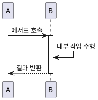

```
@startuml

participant A
participant B

A -> B : 메서드 호출
activate B

B -> B : 내부 작업 수행

B --> A : 결과 반환
deactivate B

@enduml
```

- `activate`: 실행 구간 시작
    
- `deactivate`: 실행 구간 종료
    
- `destroy`: 객체 생명선 종료
    
- `autonumber`: 메시지에 순서 번호 자동 부여
    

#### 조건 및 반복 문법

|문법|의미|
|---|---|
|`alt / else / end`|if-else 조건 분기|
|`opt / end`|조건이 만족할 때만 실행|
|`loop / end`|반복 처리|
|`par / end`|병렬 처리 표현|
|`break / end`|흐름 중단 조건|
|`critical / end`|임계 구역 표현|
|`group / end`|관련 메시지 묶기|
|`note / end note`|설명 추가|

#### 조건과 반복 예시
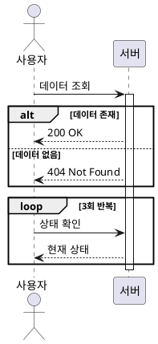

```
@startuml

actor 사용자 as User
participant 서버 as Server

User -> Server : 데이터 조회
activate Server

alt 데이터 존재
    Server --> User : 200 OK
else 데이터 없음
    Server --> User : 404 Not Found
end

loop 3회 반복
    User -> Server : 상태 확인
    Server --> User : 현재 상태
end

deactivate Server

@enduml
```

#### 실전 예시: 사용자 로그인
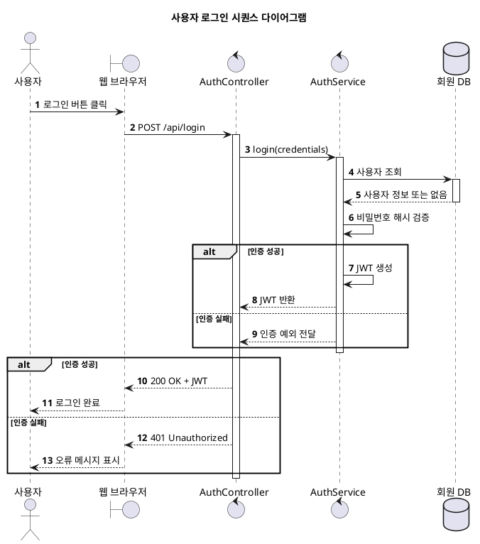

```
@startuml
title 사용자 로그인 시퀀스 다이어그램

autonumber

actor "사용자" as User
boundary "웹 브라우저" as Browser
control "AuthController" as Controller
control "AuthService" as Service
database "회원 DB" as DB

User -> Browser : 로그인 버튼 클릭
Browser -> Controller : POST /api/login
activate Controller

Controller -> Service : login(credentials)
activate Service

Service -> DB : 사용자 조회
activate DB
DB --> Service : 사용자 정보 또는 없음
deactivate DB

Service -> Service : 비밀번호 해시 검증

alt 인증 성공
    Service -> Service : JWT 생성
    Service --> Controller : JWT 반환
else 인증 실패
    Service --> Controller : 인증 예외 전달
end

deactivate Service

alt 인증 성공
    Controller --> Browser : 200 OK + JWT
    Browser --> User : 로그인 완료
else 인증 실패
    Controller --> Browser : 401 Unauthorized
    Browser --> User : 오류 메시지 표시
end

deactivate Controller

@enduml
```

시퀀스 다이어그램 작성 시 메서드 이름, 호출 순서, 분기 조건 등을 실제 구현과 가능한 한 일치시키는 것이 좋다.

단, 모든 내부 메서드까지 작성하기보다는 **설명하려는 기능에서 중요한 상호작용을 중심으로 작성한다.**

### 클래스 다이어그램(Class Diagram)

클래스 다이어그램은 시스템을 구성하는 클래스의 속성, 메서드, 클래스 사이의 관계를 나타내는 UML 구조 다이어그램이다.

객체지향 설계에서 클래스의 책임과 의존 관계를 파악하는 데 사용한다.

#### 기본 문법
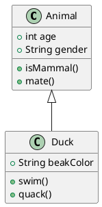

```
@startuml

class Animal {
    +int age
    +String gender
    +isMammal()
    +mate()
}

class Duck {
    +String beakColor
    +swim()
    +quack()
}

Animal <|-- Duck

@enduml
```

`Duck` 클래스가 `Animal` 클래스를 상속하는 관계를 나타낸다.

#### 접근 제어자

|기호|접근 수준|
|---|---|
|`+`|public|
|`-`|private|
|`#`|protected|
|`~`|package|

#### 클래스 관계

|문법|관계|
|---|---|
|`<\|--`|상속(일반화)|
|`<\|..`|인터페이스 구현|
|`--`|연관|
|`-->`|방향성이 있는 연관|
|`o--`|집약(Aggregation)|
|`*--`|합성(Composition)|
|`..>`|의존(Dependency)|

#### 실전 예시
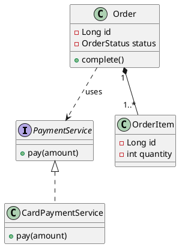

```
@startuml

interface PaymentService {
    +pay(amount)
}

class CardPaymentService {
    +pay(amount)
}

class Order {
    -Long id
    -OrderStatus status
    +complete()
}

class OrderItem {
    -Long id
    -int quantity
}

PaymentService <|.. CardPaymentService
Order "1" *-- "1..*" OrderItem
Order ..> PaymentService : uses

@enduml
```

- `PaymentService`: 인터페이스
    
- `CardPaymentService`: 인터페이스 구현체
    
- `Order`와 `OrderItem`: 합성 관계
    
- `Order`와 `PaymentService`: 의존 관계
    

실제 설계에서는 객체 생명주기와 소유 관계를 고려하여 집약 및 합성 관계를 구분해야 한다.

### PlantUML과 Mermaid 비교

| 항목          | PlantUML         | Mermaid             |
| ----------- | ---------------- | ------------------- |
| UML 표현력     | 다양한 UML 다이어그램 지원 | 일부 UML 유형 지원        |
| 시퀀스 다이어그램   | 적합               | 적합                  |
| 클래스 다이어그램   | 적합               | 간단한 구조에 적합          |
| 간트차트        | 지원               | 지원                  |
| Markdown 연동 | 렌더러 또는 플러그인 필요   | 여러 Markdown 도구에서 지원 |
| Obsidian    | 커뮤니티 플러그인 필요     | 기본 지원               |
| Git 관리      | 가능               | 가능                  |

Mermaid의 `classDiagram`, `sequenceDiagram` 역시 UML과 유사한 표현을 제공하지만, UML 표준의 모든 표현 요소를 지원하는 것은 아니다.

- 상세한 UML 설계: PlantUML
    
- 간단한 흐름도 및 일정 문서: Mermaid
    

### 활용 가이드

|개발 단계|추천 다이어그램|
|---|---|
|요구사항 분석|유스케이스|
|도메인 설계|클래스|
|기능/API 설계|시퀀스|
|비즈니스 상태 설계|상태 머신|
|업무 흐름 설계|활동|
|시스템 아키텍처 설계|컴포넌트|
|인프라 설계|배포|


### 실습 예제

#### 카우머치 프로젝트
##### 시퀀스 다이어그램
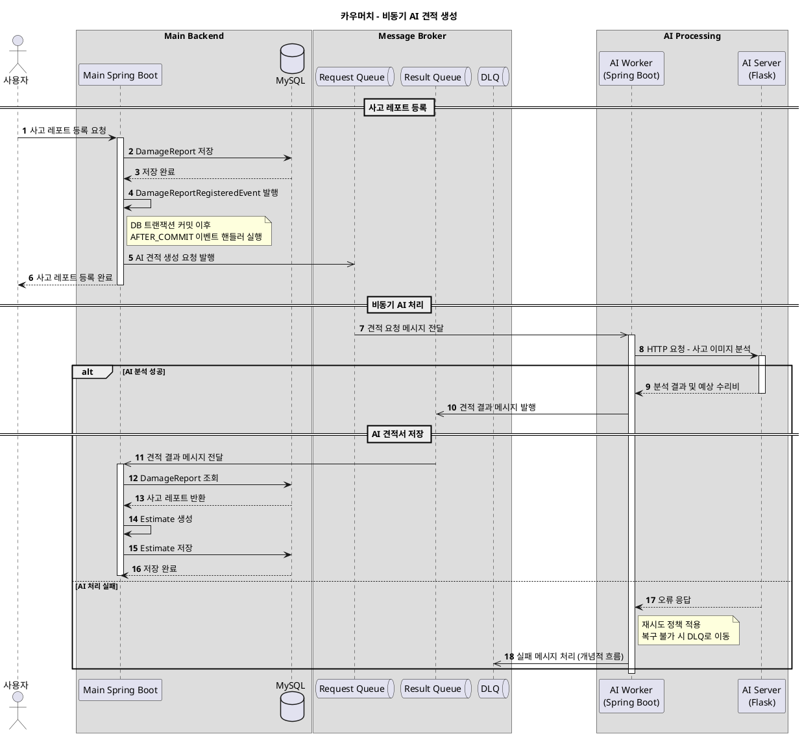
```
@startuml
title 카우머치 - 비동기 AI 견적 생성

autonumber

actor "사용자" as User

box "Main Backend"
    participant "Main Spring Boot" as Main
    database "MySQL" as DB
end box

box "Message Broker"
    queue "Request Queue" as RequestQ
    queue "Result Queue" as ResultQ
    queue "DLQ" as DLQ
end box

box "AI Processing"
    participant "AI Worker\n(Spring Boot)" as Worker
    participant "AI Server\n(Flask)" as Flask
end box

== 사고 레포트 등록 ==

User -> Main: 사고 레포트 등록 요청
activate Main

Main -> DB: DamageReport 저장
DB --> Main: 저장 완료

Main -> Main: DamageReportRegisteredEvent 발행

note right of Main
  DB 트랜잭션 커밋 이후
  AFTER_COMMIT 이벤트 핸들러 실행
end note

Main ->> RequestQ: AI 견적 생성 요청 발행
Main --> User: 사고 레포트 등록 완료
deactivate Main

== 비동기 AI 처리 ==

RequestQ ->> Worker: 견적 요청 메시지 전달
activate Worker

Worker -> Flask: HTTP 요청 - 사고 이미지 분석
activate Flask

alt AI 분석 성공
    Flask --> Worker: 분석 결과 및 예상 수리비
    deactivate Flask

    Worker ->> ResultQ: 견적 결과 메시지 발행

    == AI 견적서 저장 ==

    ResultQ ->> Main: 견적 결과 메시지 전달
    activate Main

    Main -> DB: DamageReport 조회
    DB --> Main: 사고 레포트 반환

    Main -> Main: Estimate 생성
    Main -> DB: Estimate 저장
    DB --> Main: 저장 완료

    deactivate Main

else AI 처리 실패
    Flask --> Worker: 오류 응답
    deactivate Flask

    note right of Worker
      재시도 정책 적용
      복구 불가 시 DLQ로 이동
    end note

    Worker ->> DLQ: 실패 메시지 처리 (개념적 흐름)
end

deactivate Worker

@enduml
```

#### 시스템 구성도
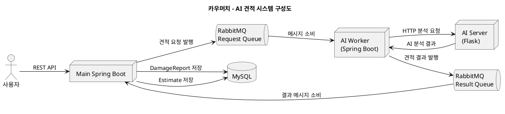

```
@startuml
title 카우머치 - AI 견적 시스템 구성도

left to right direction

actor "사용자" as User

node "Main Spring Boot" as Main
node "AI Worker\n(Spring Boot)" as Worker
node "AI Server\n(Flask)" as Flask

queue "RabbitMQ\nRequest Queue" as RequestQ
queue "RabbitMQ\nResult Queue" as ResultQ

database "MySQL" as DB

User --> Main : REST API

Main --> DB : DamageReport 저장
Main --> RequestQ : 견적 요청 발행

RequestQ --> Worker : 메시지 소비
Worker --> Flask : HTTP 분석 요청
Flask --> Worker : AI 분석 결과

Worker --> ResultQ : 견적 결과 발행
ResultQ --> Main : 결과 메시지 소비

Main --> DB : Estimate 저장

@enduml
```

##### 패키지 다이어그램
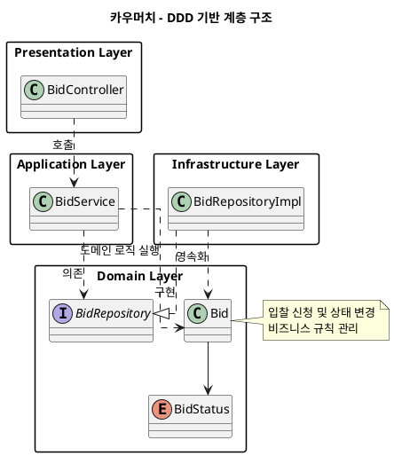

```
@startuml
title 카우머치 - DDD 기반 계층 구조

top to bottom direction
skinparam packageStyle rectangle

package "Presentation Layer" {
    class BidController
}

package "Application Layer" {
    class BidService
}

package "Domain Layer" {
    class Bid
    interface BidRepository
    enum BidStatus
}

package "Infrastructure Layer" {
    class BidRepositoryImpl
}

BidController ..> BidService : 호출
BidService ..> Bid : 도메인 로직 실행
BidService ..> BidRepository : 의존

BidRepositoryImpl ..|> BidRepository : 구현
BidRepositoryImpl ..> Bid : 영속화

Bid --> BidStatus

note right of Bid
    입찰 신청 및 상태 변경
    비즈니스 규칙 관리
end note

@enduml
```
#### 핏 프로젝트
##### 시퀀스 다이어그램
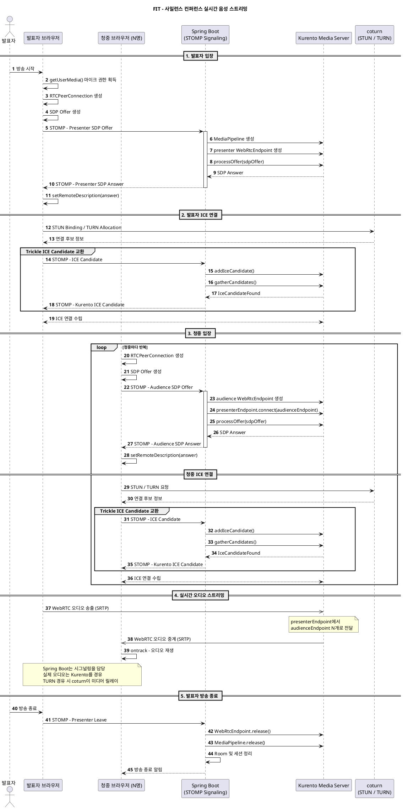

```
@startuml
title FIT - 사일런스 컨퍼런스 실시간 음성 스트리밍

autonumber

actor "발표자" as Presenter
participant "발표자 브라우저" as PB
participant "청중 브라우저 (N명)" as AB
participant "Spring Boot\n(STOMP Signaling)" as Spring
participant "Kurento Media Server" as KMS
participant "coturn\n(STUN / TURN)" as TURN

== 1. 발표자 입장 ==

Presenter -> PB : 방송 시작
PB -> PB : getUserMedia() 마이크 권한 획득
PB -> PB : RTCPeerConnection 생성
PB -> PB : SDP Offer 생성

PB -> Spring : STOMP - Presenter SDP Offer
activate Spring

Spring -> KMS : MediaPipeline 생성
Spring -> KMS : presenter WebRtcEndpoint 생성
Spring -> KMS : processOffer(sdpOffer)
KMS --> Spring : SDP Answer

Spring --> PB : STOMP - Presenter SDP Answer
deactivate Spring

PB -> PB : setRemoteDescription(answer)

== 2. 발표자 ICE 연결 ==

PB -> TURN : STUN Binding / TURN Allocation
TURN --> PB : 연결 후보 정보

group Trickle ICE Candidate 교환
    PB -> Spring : STOMP - ICE Candidate
    Spring -> KMS : addIceCandidate()

    Spring -> KMS : gatherCandidates()
    KMS --> Spring : IceCandidateFound
    Spring --> PB : STOMP - Kurento ICE Candidate
end

PB <--> KMS : ICE 연결 수립

== 3. 청중 입장 ==

loop 청중마다 반복
    AB -> AB : RTCPeerConnection 생성
    AB -> AB : SDP Offer 생성

    AB -> Spring : STOMP - Audience SDP Offer
    activate Spring

    Spring -> KMS : audience WebRtcEndpoint 생성
    Spring -> KMS : presenterEndpoint.connect(audienceEndpoint)
    Spring -> KMS : processOffer(sdpOffer)
    KMS --> Spring : SDP Answer

    Spring --> AB : STOMP - Audience SDP Answer
    deactivate Spring

    AB -> AB : setRemoteDescription(answer)

    == 청중 ICE 연결 ==

    AB -> TURN : STUN / TURN 요청
    TURN --> AB : 연결 후보 정보

    group Trickle ICE Candidate 교환
        AB -> Spring : STOMP - ICE Candidate
        Spring -> KMS : addIceCandidate()

        Spring -> KMS : gatherCandidates()
        KMS --> Spring : IceCandidateFound
        Spring --> AB : STOMP - Kurento ICE Candidate
    end

    AB <--> KMS : ICE 연결 수립
end

== 4. 실시간 오디오 스트리밍 ==

PB ->> KMS : WebRTC 오디오 송출 (SRTP)

note over KMS
  presenterEndpoint에서
  audienceEndpoint N개로 전달
end note

KMS ->> AB : WebRTC 오디오 중계 (SRTP)
AB -> AB : ontrack - 오디오 재생

note over PB, AB
  Spring Boot는 시그널링을 담당
  실제 오디오는 Kurento를 경유
  TURN 경유 시 coturn이 미디어 릴레이
end note

== 5. 발표자 방송 종료 ==

Presenter -> PB : 방송 종료
PB -> Spring : STOMP - Presenter Leave

Spring -> KMS : WebRtcEndpoint.release()
Spring -> KMS : MediaPipeline.release()
Spring -> Spring : Room 및 세션 정리

Spring --> AB : 방송 종료 알림

@enduml
```

##### 시스템 구성도
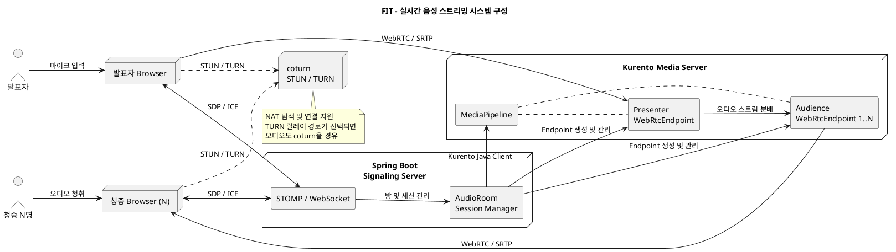

```
@startuml
title FIT - 실시간 음성 스트리밍 시스템 구성

left to right direction
skinparam componentStyle rectangle

actor "발표자" as Presenter
actor "청중 N명" as Audience

node "발표자 Browser" as PB
node "청중 Browser (N)" as AB

node "Spring Boot\nSignaling Server" as Spring {
    component "STOMP / WebSocket" as WS
    component "AudioRoom\nSession Manager" as Room
}

node "Kurento Media Server" as KMS {
    component "MediaPipeline" as Pipeline
    component "Presenter\nWebRtcEndpoint" as PE
    component "Audience\nWebRtcEndpoint 1..N" as AE
}

node "coturn\nSTUN / TURN" as TURN

Presenter --> PB : 마이크 입력
Audience --> AB : 오디오 청취

PB <--> WS : SDP / ICE
AB <--> WS : SDP / ICE

WS --> Room : 방 및 세션 관리

Room --> Pipeline : Kurento Java Client
Room --> PE : Endpoint 생성 및 관리
Room --> AE : Endpoint 생성 및 관리

Pipeline .. PE
Pipeline .. AE

PB --> PE : WebRTC / SRTP
PE --> AE : 오디오 스트림 분배
AE --> AB : WebRTC / SRTP

PB ..> TURN : STUN / TURN
AB ..> TURN : STUN / TURN

note bottom of TURN
  NAT 탐색 및 연결 지원
  TURN 릴레이 경로가 선택되면
  오디오도 coturn을 경유
end note

@enduml
```

#### 실습에 필요한 문법 목록

##### 기본 문법

|문법|설명|
|---|---|
|`@startuml`|PlantUML 다이어그램 시작|
|`@enduml`|PlantUML 다이어그램 종료|
|`title 제목`|다이어그램 제목 설정|
|`as`|요소에 별칭 지정|
|`\n`|요소의 표시 이름에서 줄바꿈|
|`' 주석`|한 줄 주석 작성|
|`left to right direction`|전체 다이어그램을 좌우 방향으로 배치|
|`top to bottom direction`|전체 다이어그램을 상하 방향으로 배치|
|`skinparam`|다이어그램의 모양, 색상, 스타일 등 설정|

##### 요소 선언

|문법|설명|
|---|---|
|`actor`|사용자 또는 외부 행위자|
|`participant`|시퀀스 다이어그램의 일반 참여 객체|
|`database`|데이터베이스|
|`queue`|메시지 큐|
|`node`|서버, 실행 환경 등의 노드|
|`component`|시스템을 구성하는 컴포넌트|
|`package`|패키지 또는 논리적인 요소 그룹|
|`class`|클래스|
|`interface`|인터페이스|
|`enum`|열거형|

##### 요소 그룹화 및 스타일

|문법|설명|
|---|---|
|`box "이름" ... end box`|시퀀스 다이어그램에서 여러 참여자를 하나의 영역으로 그룹화|
|`node "이름" { ... }`|노드 내부에 여러 구성 요소 배치|
|`package "이름" { ... }`|패키지 내부에 클래스 및 인터페이스 배치|
|`skinparam packageStyle rectangle`|패키지를 사각형 스타일로 표시|
|`skinparam componentStyle rectangle`|컴포넌트를 사각형 스타일로 표시|


##### 시퀀스 다이어그램 문법

###### 메시지 및 호출

|문법|설명|
|---|---|
|`A -> B : 메시지`|A에서 B로 실선 메시지 전달|
|`A --> B : 응답`|A에서 B로 점선 메시지 전달. 일반적으로 반환 메시지에 사용|
|`A ->> B : 메시지`|열린 화살표로 메시지 전달. 비동기 메시지 표현에 활용|
|`A <--> B : 메시지`|양방향 점선 메시지 또는 관계 표현|
|`A -> A : 메서드()`|자기 자신에게 메시지 전달. 내부 호출 표현|
|`: 메시지`|화살표에 전달 내용 또는 메서드명 표시|

`->>`는 비동기 메시지 표현에 자주 사용하지만, 실제 비동기 실행 여부를 자동으로 보장하는 것은 아니다.

###### 실행 및 생명주기

|문법|설명|
|---|---|
|`activate A`|참여자 A의 실행 구간 활성화|
|`deactivate A`|참여자 A의 실행 구간 종료|
|`destroy A`|참여자 A의 생명선 종료|
|`autonumber`|메시지 순서 번호 자동 부여|
|`== 구간 이름 ==`|시퀀스 흐름을 단계별로 구분|

###### 조건 및 반복

|문법|설명|
|---|---|
|`alt 조건`|조건에 따른 분기 시작|
|`else 조건`|다른 조건의 처리 흐름|
|`opt 조건`|조건이 충족될 때만 수행|
|`loop 조건`|반복 처리 구간|
|`group 이름`|관련 메시지를 하나의 그룹으로 묶기|
|`par`|병렬 처리 흐름을 표현|
|`break`|특정 조건에서 흐름 중단 표현|
|`critical`|임계 구역 표현|
|`end`|조건, 반복, 그룹 등의 블록 종료|

###### 설명 추가

|문법|설명|
|---|---|
|`note right of A`|참여자 A 오른쪽에 설명 표시|
|`note left of A`|참여자 A 왼쪽에 설명 표시|
|`note over A`|참여자 A 위에 설명 표시|
|`note over A, B`|A와 B에 걸쳐 설명 표시|
|`end note`|여러 줄 설명 종료|


##### 시스템 구성도 및 패키지 다이어그램 문법

###### 구성 요소 간 관계

|문법|설명|
|---|---|
|`A --> B`|A에서 B로 향하는 실선 연결|
|`A -- B`|방향 없는 실선 연결|
|`A ..> B`|A에서 B로 향하는 점선 의존 관계|
|`A .. B`|방향 없는 점선 연결|
|`A <--> B`|양방향 점선 연결|
|`A --|> B`|일반화(상속) 관계|
|`A ..|> B`|실체화(인터페이스 구현) 관계|
|`A *-- B`|합성(Composition) 관계|
|`A o-- B`|집약(Aggregation) 관계|
|`A --> B : 설명`|연결 관계에 설명 추가|

###### 구성 요소 표현 예시

|문법|설명|
|---|---|
|`node "Main Spring Boot" as Main`|Spring Boot 서버 노드 선언|
|`queue "RabbitMQ" as MQ`|RabbitMQ 메시지 큐 선언|
|`database "MySQL" as DB`|MySQL 데이터베이스 선언|
|`component "STOMP" as WS`|STOMP 컴포넌트 선언|
|`package "Domain Layer" { ... }`|도메인 계층을 패키지로 그룹화|
|`interface BidRepository`|저장소 인터페이스 선언|
|`class BidService`|서비스 클래스 선언|
|`enum BidStatus`|상태 열거형 선언|

###### 추가 설명

|문법|설명|
|---|---|
|`note right of A`|요소 A 오른쪽에 설명 추가|
|`note bottom of A`|요소 A 아래쪽에 설명 추가|
|`end note`|여러 줄 설명 종료|


##### 문법 사용 시 주의사항

###### 1. 다이어그램 종류에 따른 화살표 차이

시퀀스 다이어그램에서는 `-->`를 일반적으로 반환 메시지로 사용하지만, 시스템 구성도에서는 화살표 방향이 있는 실선 연결로 표현된다.

따라서 같은 문법이라도 다이어그램 종류에 따라 표시 방식과 해석이 달라질 수 있다.

###### 2. 실행 흐름과 시스템 구조 구분

- 시퀀스 다이어그램: 객체 간 호출 순서, 응답, 분기, 반복을 표현
    
- 시스템 구성도: 서버, 데이터베이스, 메시지 큐 등의 연결 관계를 표현
    
- 패키지 다이어그램: 패키지 및 계층의 의존 관계를 표현
    

###### 3. 논리적 연결과 실제 통신 구분

`A --> B`는 두 구성 요소의 연결 방향을 보여줄 뿐, HTTP, WebSocket, AMQP 같은 실제 통신 프로토콜을 자동으로 정의하지 않는다.

실제 기술적 의미를 명확하게 전달하려면 다음처럼 연결에 설명을 추가하는 것이 좋다.

```
@startuml
left to right direction

node "Spring Boot" as Spring
node "Kurento" as KMS
database "MySQL" as DB

Spring --> KMS : JSON-RPC
Spring --> DB : JDBC / SQL

@enduml
```

## 📚 참고 및 링크
- [[]]

---

## 🔗 관련 노트
- [[../02 MOCs/Design|Design]]