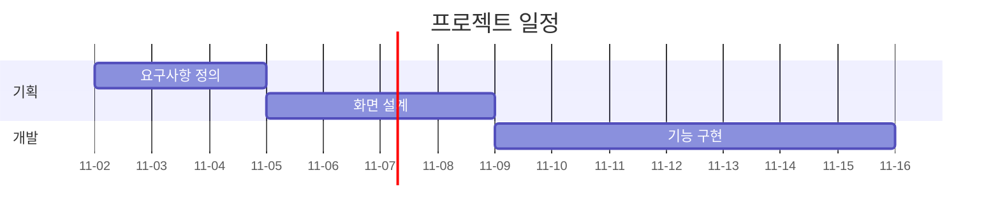
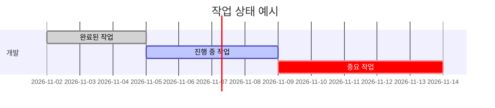
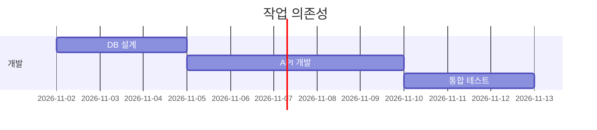
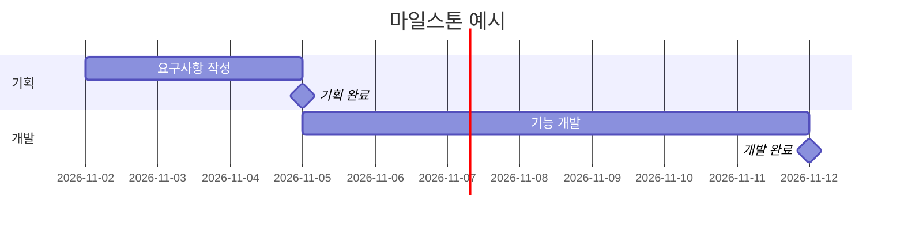
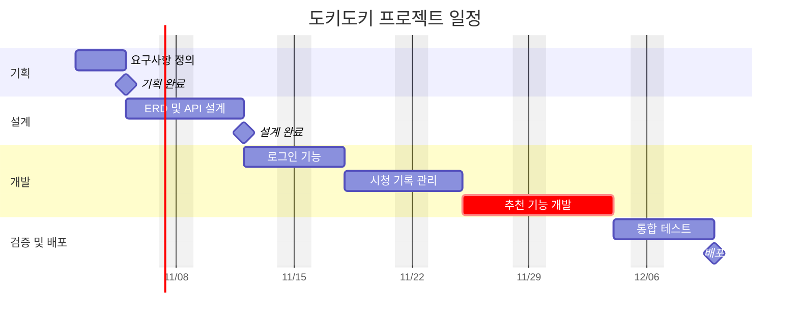
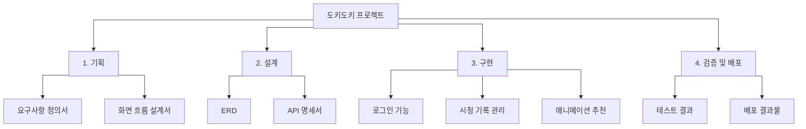

# 간트차트

---

## 📄 본문

### 간트차트(Gantt Chart)란?

간트차트는 **프로젝트의 작업 일정과 진행 기간을 시간축을 기준으로 시각화한 일정 관리 도구**이다.

각 작업의 시작일과 종료일을 가로 막대로 표현하여 프로젝트의 전체 일정, 작업 순서, 작업 간 의존성 및 진행 상황 등을 확인할 수 있다.

주로 프로젝트 계획 수립, 일정 관리, 진척도 확인에 활용한다.

### 간트차트의 구성 요소

|구성 요소|설명|
|---|---|
|Task|프로젝트의 개별 작업|
|Start Date|작업 시작일|
|End Date|작업 종료일|
|Duration|작업 수행 기간|
|Dependency|선행 작업과의 의존 관계|
|Milestone|주요 단계 완료 또는 중요 시점|
|Progress|작업 진행 상태 또는 진척도|
|Critical Path|프로젝트 최소 완료 기간을 결정하는 작업 경로|

간트차트 자체에 모든 정보가 반드시 포함되는 것은 아니며, 도구에 따라 제공 기능이 달라진다.

### WBS(Work Breakdown Structure)란?

WBS는 프로젝트의 전체 작업 범위를 관리 가능한 단위로 계층적으로 분해한 작업 분할 구조이다.

일반적으로 프로젝트의 최종 산출물을 기준으로 하위 산출물과 작업 패키지(Work Package)를 나누어 구성한다.

**WBS는 무엇을 완성해야 하는지 정의하고, 간트차트는 각 작업을 언제 수행할지 표현한다.**

#### WBS 구성 예시

도키도키 프로젝트를 기준으로 작성한 WBS 예시이다.

```
1. 도키도키 프로젝트
│
├── 1.1 기획 산출물
│   ├── 1.1.1 요구사항 정의서
│   └── 1.1.2 화면 흐름 설계서
│
├── 1.2 설계 산출물
│   ├── 1.2.1 ERD
│   ├── 1.2.2 API 명세서
│   └── 1.2.3 시스템 아키텍처 설계서
│
├── 1.3 기능 구현 결과물
│   ├── 1.3.1 로그인 기능
│   ├── 1.3.2 시청 완료 및 평가 관리 기능
│   ├── 1.3.3 시청 탈출 및 이유 관리 기능
│   └── 1.3.4 애니메이션 추천 기능
│
└── 1.4 검증 및 배포 산출물
    ├── 1.4.1 테스트 결과
    └── 1.4.2 배포된 애플리케이션
```

WBS를 작성할 때는 상위 산출물을 하위 산출물로 나누고, 하위 항목들이 상위 작업 범위를 빠짐없이 포함하도록 구성하는 것이 중요하다.

#### WBS와 작업 목록의 차이

WBS는 산출물 또는 작업 범위의 계층 구조를 나타낸다.

반면 작업 목록(Task List)은 해당 산출물을 만들기 위해 수행해야 할 실제 활동을 정리한다.

예시:

- WBS: API 명세서
    
- 작업: 엔드포인트 정의, 요청/응답 스키마 작성, 오류 코드 정리
    

실무에서는 WBS의 작업 패키지를 세부 작업으로 분해하여 일정과 담당자를 배정할 수 있다.

### WBS와 간트차트의 관계

|구분|WBS|간트차트|
|---|---|---|
|핵심 질문|무엇을 만들어야 하는가?|언제 수행해야 하는가?|
|목적|작업 범위 관리|일정 관리|
|표현|계층 구조|시간축과 막대|
|중심 정보|산출물, 작업 패키지|시작일, 기간, 의존성|
|작성 시점|범위 정의 단계|일정 계획 단계|

일반적인 진행 순서는 다음과 같다.

1. 프로젝트 요구사항 정의
    
2. WBS 작성
    
3. 작업 패키지별 세부 작업 도출
    
4. 작업 간 의존성 및 기간 산정
    
5. 담당자 및 일정 배정
    
6. 간트차트 작성
    
7. 진행 상황에 따라 일정 갱신
    

WBS 번호를 작업 ID나 이슈에 연결하면 요구사항, 작업, 일정, 산출물을 추적하기 쉬워진다.

### 간트차트 작성 도구

|도구|특징|추천 용도|
|---|---|---|
|Mermaid|텍스트로 간트차트 작성|Obsidian, Markdown 문서|
|Excel / Google Sheets|표 기반 일정 및 간트 구성|간단한 일정 관리|
|Microsoft Project|전문 프로젝트 일정 관리|복잡한 프로젝트 관리|
|Jira|이슈 기반 작업 관리, 플랜 기능 제공|팀 단위 개발 프로젝트|
|Notion|데이터베이스 및 타임라인|개인 또는 소규모 프로젝트|
|GitHub Projects|이슈, 상태, 반복 주기, 로드맵 관리|GitHub 기반 개발|
|ClickUp|작업 및 일정 관리, 간트 뷰 제공|프로젝트 협업|

GitHub Projects의 일반적인 Roadmap 뷰와 전문 일정 관리 도구의 간트차트는 제공 기능이 다를 수 있다.

#### 추천 조합

**개인 학습 및 기술 문서 관리**

- Obsidian + Mermaid
    

**GitHub 기반 개인 개발**

- GitHub Issues + GitHub Projects
    
- Obsidian 또는 저장소 Markdown의 Mermaid
    

**팀 단위 실무 프로젝트**

- Jira 또는 팀에서 채택한 프로젝트 관리 도구
    
- 설계 문서는 PlantUML 또는 Mermaid
    

### Mermaid란?

Mermaid는 텍스트 문법으로 다양한 다이어그램을 생성하는 도구이다.

Markdown 코드 블록 안에 Mermaid 문법을 작성하면 지원하는 환경에서 다이어그램으로 렌더링된다.

지원하는 대표적인 다이어그램은 다음과 같다.

- Flowchart
    
- Sequence Diagram
    
- Class Diagram
    
- Entity Relationship Diagram
    
- Gantt Chart
    
- Timeline
    
- State Diagram
    

### Obsidian에서 Mermaid 사용

Obsidian은 Mermaid를 기본 지원하므로 별도의 플러그인을 설치하지 않아도 된다.

#### 기본 사용법


````

````

1. Obsidian에서 마크다운 노트를 생성한다.
    
2. `mermaid` 코드 블록을 작성한다.
    
3. 내부에 다이어그램 문법을 입력한다.
    
4. 읽기 모드 또는 Live Preview에서 확인한다.
    

렌더링에 사용되는 Mermaid 버전은 Obsidian 버전에 따라 달라질 수 있다.

### Mermaid 간트차트 문법

#### 기본 구조


```
gantt
    title 프로젝트 일정
    dateFormat YYYY-MM-DD
    axisFormat %m-%d

    section 기획
    요구사항 정의 :t1, 2026-11-02, 3d
    화면 설계 :t2, after t1, 4d

    section 개발
    기능 구현 :t3, after t2, 7d
```

#### 기본 설정

|문법|역할|
|---|---|
|`gantt`|간트차트 선언|
|`title`|차트 제목|
|`dateFormat`|입력 날짜 형식|
|`axisFormat`|날짜 축 표시 형식|
|`section`|작업 그룹|
|`excludes weekends`|주말을 작업 기간 계산에서 제외|
|`%%`|주석|

#### 작업 정의 형식

```
작업명 : 상태, 작업ID, 시작일, 기간
```

예시:

```
요구사항 정의 :t1, 2026-11-02, 5d
```

- `요구사항 정의`: 작업명
    
- `t1`: 작업 고유 ID
    
- `2026-11-02`: 시작일
    
- `5d`: 작업 기간
    

#### 기간 단위

|단위|의미|
|---|---|
|`s`|초|
|`m`|분|
|`h`|시간|
|`d`|일|
|`w`|주|
|`M`|월|
|`y`|년|

#### 작업 상태

|문법|의미|
|---|---|
|`done`|완료된 작업|
|`active`|진행 중인 작업|
|`crit`|중요 경로로 강조할 작업|
|`milestone`|주요 시점 표시|

`crit`는 차트에서 작업을 강조하는 표시이며, Mermaid가 실제 임계 경로를 자동 계산한다는 의미는 아니다.

#### 상태 표시 예시


```
gantt
    title 작업 상태 예시
    dateFormat YYYY-MM-DD

    section 개발
    완료된 작업 :done, t1, 2026-11-02, 3d
    진행 중 작업 :active, t2, after t1, 4d
    중요 작업 :crit, t3, after t2, 5d
```

#### 작업 의존성

`after` 키워드를 사용하면 선행 작업이 끝난 이후 다음 작업이 시작되도록 표현할 수 있다.


```
gantt
    title 작업 의존성
    dateFormat YYYY-MM-DD

    section 개발
    DB 설계 :db, 2026-11-02, 3d
    API 개발 :api, after db, 5d
    통합 테스트 :test, after api, 3d
```

- DB 설계 완료 후 API 개발 시작
    
- API 개발 완료 후 통합 테스트 시작
    

#### 마일스톤

마일스톤(Milestone)은 프로젝트의 중요한 완료 시점이나 기준점을 나타낸다.


```
gantt
    title 마일스톤 예시
    dateFormat YYYY-MM-DD

    section 기획
    요구사항 작성 :t1, 2026-11-02, 3d
    기획 완료 :milestone, m1, after t1, 0d

    section 개발
    기능 개발 :t2, after m1, 7d
    개발 완료 :milestone, m2, after t2, 0d
```

`milestone`과 `0d`를 사용하면 기간이 없는 특정 시점을 표시할 수 있다.

---

### 실전 예시: 도키도키 프로젝트 개발 일정

다음은 학습용 가상 일정이다. 실제 소요 기간을 확정한 계획은 아니다.


```
gantt
    title 도키도키 프로젝트 일정
    dateFormat YYYY-MM-DD
    axisFormat %m/%d
    excludes weekends

    section 기획
    요구사항 정의 :req, 2026-11-02, 3d
    기획 완료 :milestone, m1, after req, 0d

    section 설계
    ERD 및 API 설계 :design, after req, 5d
    설계 완료 :milestone, m2, after design, 0d

    section 개발
    로그인 기능 :auth, after design, 4d
    시청 기록 관리 :record, after auth, 5d
    추천 기능 개발 :crit, recommend, after record, 7d

    section 검증 및 배포
    통합 테스트 :test, after recommend, 4d
    배포 :milestone, deploy, after test, 0d
```

#### 작성 시 고려 사항

- 작업은 가능한 한 구체적인 단위로 나눈다.
    
- 선행 작업이 필요한 경우 의존성을 표시한다.
    
- 중요 단계는 마일스톤으로 표시한다.
    
- 불확실성이 큰 작업에는 일정 여유를 고려한다.
    
- 실제 진행 상황과 일정표가 달라지면 갱신한다.
    

특히 여러 개발자가 동시에 작업하는 프로젝트에서는 모든 작업을 직렬로 연결하기보다 실제 병렬 진행 가능성을 고려해야 한다.

---

### Obsidian에서 WBS 시각화

Mermaid Flowchart를 사용하면 WBS 구조도 시각적으로 표현할 수 있다.


```
flowchart TD
    P["도키도키 프로젝트"]

    P --> A["1. 기획"]
    P --> B["2. 설계"]
    P --> C["3. 구현"]
    P --> D["4. 검증 및 배포"]

    A --> A1["요구사항 정의서"]
    A --> A2["화면 흐름 설계서"]

    B --> B1["ERD"]
    B --> B2["API 명세서"]

    C --> C1["로그인 기능"]
    C --> C2["시청 기록 관리"]
    C --> C3["애니메이션 추천"]

    D --> D1["테스트 결과"]
    D --> D2["배포 결과물"]
```

이 구조는 WBS의 계층 관계를 간단히 시각화한 예시다.

### 실무 활용 가이드

프로젝트 관리에서는 다음과 같이 각 도구의 역할을 분리하여 사용하는 것이 좋다.

|관리 대상|추천 방법|
|---|---|
|요구사항|Markdown 문서, 이슈|
|WBS|Markdown, 스프레드시트, Flowchart|
|작업 및 담당자|GitHub Issues, Jira|
|개발 진행 상태|GitHub Projects, Jira 보드|
|전체 일정|간트차트, Roadmap|
|설계 다이어그램|PlantUML, Mermaid|
|기술 문서|Obsidian, Git 저장소 Markdown|

개인 프로젝트라면 다음과 같은 흐름으로 관리할 수 있다.

**요구사항 정의 → WBS 작성 → GitHub Issues 등록 → 일정 계획 → Mermaid 간트차트 작성 → 개발 및 검증**

기술 학습 문서는 Obsidian에 작성하고, 프로젝트에서 실제로 관리해야 할 산출물은 Git 저장소의 `docs/`에서도 관리하면 팀과 AI 개발 도구가 문서를 함께 참조하기 쉽다.

---

## 📚 참고 및 링크
- 

---

## 🔗 관련 노트
- [[../02 MOCs/Project|Project]]