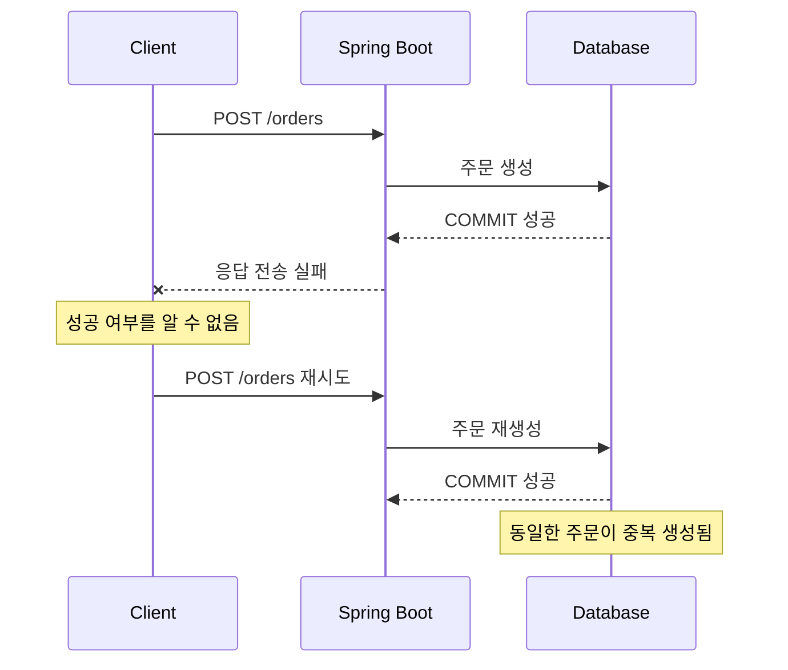
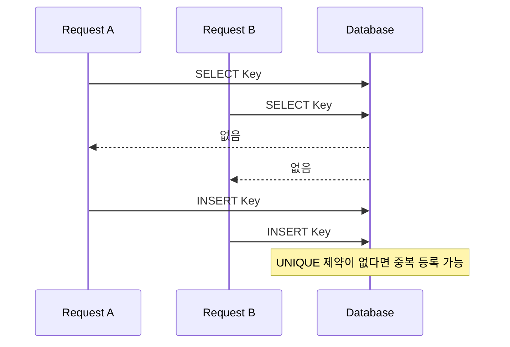
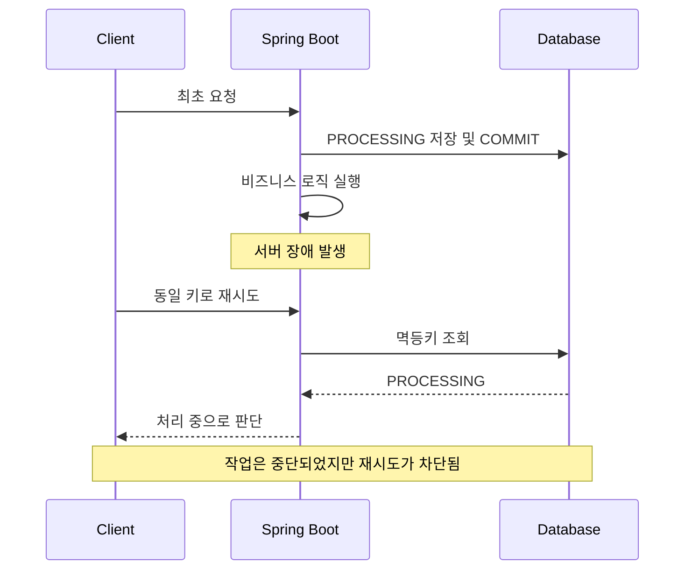

# 멱등성

---

## 📄 본문

### 멱등성 (Idempotency)

멱등성이란 동일한 연산을 여러 번 수행하더라도 한 번 수행한 것과 결과 상태가 동일하게 유지되는 성질을 의미한다.

수학적으로는 `f(f(x)) = f(x)`로 표현할 수 있다.

HTTP에서 멱등성이란 **동일한 요청을 여러 번 전송하더라도 서버에 미치는 의도된 효과가 한 번 요청했을 때와 동일한 것**을 의미한다.

주의할 점은 멱등성이 동일한 HTTP 응답을 보장한다는 뜻은 아니라는 것이다.

예를 들어 리소스를 삭제하는 DELETE 요청을 두 번 수행했을 때 첫 번째 요청은 `204 No Content`, 두 번째 요청은 `404 Not Found`가 반환될 수 있다. 하지만 리소스가 삭제된 최종 상태는 동일하므로 멱등성을 만족한다.

또한 요청 로그가 여러 번 기록되거나 조회수가 증가하는 것 같은 부수적인 효과가 존재하더라도, HTTP 메서드의 의도된 효과가 동일하다면 멱등성을 만족할 수 있다.

### 멱등성이 왜 중요한가?

네트워크 통신은 항상 신뢰할 수 있는 환경에서 이루어지지 않는다.

클라이언트가 요청을 전송한 이후 서버에서 작업이 정상적으로 완료되었더라도, 응답이 클라이언트에 도달하지 못하는 상황이 발생할 수 있다.

이러한 상황에서 클라이언트는 요청의 성공 여부를 정확하게 판단할 수 없으므로 동일한 요청을 다시 전송할 수 있다.

**멱등성이 보장되지 않은 API에서 요청이 중복 실행된다면 데이터 중복 생성, 중복 결제, 재고 중복 차감 등의 문제가 발생할 수 있다.**

멱등성은 이러한 중복 실행의 부작용을 방지하고, 장애 상황에서 안전하게 요청을 재시도할 수 있도록 하는 중요한 성질이다.

### HTTP 메서드별 멱등성

|HTTP 메서드|멱등성|설명|
|---|---|---|
|GET|✅|동일한 조회 요청은 의도된 서버 상태를 변경하지 않음|
|HEAD|✅|응답 본문 없이 리소스 메타데이터 조회|
|OPTIONS|✅|리소스의 통신 옵션 조회|
|PUT|✅|동일한 리소스 상태로 반복하여 저장|
|DELETE|✅|반복해서 삭제하더라도 삭제된 최종 상태는 동일|
|PATCH|⚠️|구현 방식에 따라 멱등성을 가질 수 있음|
|POST|❌|기본적으로 멱등성을 보장하지 않음|

- `PUT /users/1` : 동일한 사용자 데이터로 여러 번 갱신하더라도 최종 상태는 동일하다.
    
- `DELETE /users/1` : 여러 번 삭제하더라도 리소스가 삭제된 상태는 동일하다.
    
- `PATCH /users/1` : 나이를 25로 설정하는 방식은 멱등하게 구현할 수 있지만, 나이를 1 증가시키는 방식은 멱등하지 않다.
    
- `POST /orders` : 동일한 주문 생성 요청이 여러 번 수행되면 주문이 중복 생성될 수 있다.
    

HTTP 메서드의 멱등성은 메서드의 의미를 기준으로 정의된다. 실제 구현이 메서드의 의미를 위반하면 기대한 멱등성이 깨질 수 있다.

> [!NOTE] 핵심  
> POST와 PATCH는 기본적으로 멱등성을 보장하지 않지만, API 설계와 멱등키 등의 방법을 통해 멱등하게 구현할 수 있다. 모든 POST와 PATCH 요청에 멱등키가 필요한 것은 아니며, 중복 실행으로 문제가 발생할 수 있는 작업에 우선 적용한다.

### 어떻게 문제가 발생하는가?

대표적으로 다음과 같은 상황에서 중복 요청이 발생할 수 있다.

1. **사용자의 예기치 못한 행동** : 버튼을 연속해서 클릭하거나 새로고침하는 경우
    
2. **불안정한 네트워크 환경** : 요청이 처리되었지만 응답이 유실되는 경우
    
3. **처리 시간 지연** : 응답이 늦어 클라이언트가 타임아웃 후 재요청하는 경우
    
4. **자동 재시도** : 클라이언트나 네트워크 계층에서 재시도를 수행하는 경우
    
5. **비동기 메시지 재전달** : 메시지 큐에서 동일한 메시지가 여러 번 소비되는 경우
    

특히 중요한 것은 **서버에서 작업이 정상적으로 처리되었지만 클라이언트가 응답을 받지 못한 상황**이다.



### 멱등한 API는 어떻게 만들 수 있을까?

서버는 클라이언트의 동일한 HTTP 요청이 새로운 비즈니스 작업인지, 이전 작업의 재시도인지 요청 내용만으로 구분하기 어려울 수 있다.

따라서 클라이언트가 하나의 논리적 작업을 식별할 수 있는 고유한 값을 함께 전달하도록 설계할 수 있다.

이를 **멱등키(Idempotency Key)** 라고 한다.

서버는 멱등키를 기준으로 기존 요청의 처리 여부를 확인하고, 동일한 비즈니스 작업이 중복 실행되는 것을 방지한다.

다만 멱등키는 여러 구현 방법 중 하나이며, 서버에서 비즈니스 고유 식별자나 DB UNIQUE 제약조건을 활용해 멱등성을 보장하는 것도 가능하다.

#### 멱등키 생성 및 전달

클라이언트는 하나의 논리적 작업을 시작할 때 고유한 멱등키를 생성한다.

일반적으로 UUID v4와 같이 충분한 무작위성을 갖는 식별자를 사용한다.

JavaScript에서는 별도 라이브러리 없이 다음과 같이 생성할 수 있다.

```jsx
const idempotencyKey = crypto.randomUUID();
```

요청 시 `Idempotency-Key` HTTP 헤더에 함께 전달한다.

```json
POST /api/orders HTTP/1.1
Content-Type: application/json
Idempotency-Key: "8e03978e-40d5-43e8-bc93-6894a57f9324"
```

IETF의 Idempotency-Key 초안에서는 헤더값을 Structured Field String 형식으로 정의하므로 위 예시처럼 따옴표를 포함한다. 서버에서도 이 형식에 맞게 헤더를 파싱하고 검증해야 한다.

**멱등키는 HTTP 요청을 보낼 때마다 새로 생성하는 것이 아니라, 하나의 논리적 작업마다 생성한다.**

- 새로운 주문 생성 : 새로운 멱등키 발급
    
- 동일한 주문의 재시도 : 기존 멱등키 재사용
    
- 새로운 주문을 다시 시작 : 새로운 멱등키 발급
    

프론트엔드에서는 재시도 과정에서 같은 키를 유지해야 한다. 페이지 새로고침 이후에도 재시도해야 하는 작업이라면 키의 임시 저장 및 복구 정책을 별도로 고려한다.

#### 멱등키와 요청 데이터 검증

동일한 멱등키라고 해서 무조건 이전 응답을 반환해서는 안 된다.

예를 들어 다음과 같이 같은 키로 서로 다른 주문 요청이 들어올 수 있기 때문이다.

```json
{
  "productId": 1,
  "quantity": 2
}
```

```json
{
  "productId": 1,
  "quantity": 5
}
```

이를 방지하기 위해 서버는 요청 데이터로부터 **Fingerprint(요청 지문)** 를 생성하여 멱등키와 함께 관리할 수 있다.

예를 들어 핵심 요청 데이터를 정규화한 후 SHA-256 해시를 생성하는 방식이다.

이때 JSON 필드 순서, 공백 등의 표현 차이 때문에 논리적으로 동일한 요청이 서로 다른 해시를 생성하지 않도록 정규화 기준을 결정해야 한다.

멱등성 기록은 일반적으로 다음 범위로 관리하는 것이 안전하다.

`사용자 식별자 + 작업 종류 + 멱등키`

요청 데이터의 Fingerprint는 같은 작업인지 검증하는 용도로 별도로 저장한다.

#### 중복 요청에 대한 HTTP 응답

IETF의 Idempotency-Key HTTP Header 초안에서는 다음과 같은 응답을 권장한다.

|상황|HTTP 응답|설명|
|---|---|---|
|최초 요청|정상 응답|비즈니스 로직 실행|
|동일 키 + 처리 완료|기존 작업 결과에 부합하는 응답|중복 실행 방지|
|동일 키 + 처리 중|409 Conflict|이미 처리 중인 요청 존재|
|동일 키 + 다른 요청 데이터|422 Unprocessable Content|멱등키 재사용 오류|
|멱등키 필수 API에서 키 누락|400 Bad Request|필수 헤더 누락|

처리 완료 후에는 저장된 상태 코드와 응답 본문을 재사용하거나, 기존 리소스를 조회하여 완료된 작업에 부합하는 응답을 제공할 수 있다.

오류 응답을 캐싱할지, 재시도를 허용할지는 실패가 발생한 시점과 비즈니스 작업의 실제 반영 여부에 따라 정책을 결정해야 한다.

예를 들어 요청 검증 단계에서 실패하여 실제 작업이 시작되지 않았다면 멱등성 결과를 저장하지 않을 수 있다.

### 중복 요청 처리 방법

서버는 요청의 중복 여부와 처리 결과를 확인할 수 있도록 멱등성 기록을 관리해야 한다.

일반적으로 `PROCESSING`, `COMPLETED` 상태를 사용한다.

```java
public enum ProgressStatus {
    PROCESSING,
    COMPLETED
}
```

- `PROCESSING` : 최초 요청을 선점하고 비즈니스 작업을 처리 중인 상태
    
- `COMPLETED` : 비즈니스 작업이 완료되었으며 중복 요청에 대한 결과를 제공할 수 있는 상태
    

`FAILED` 상태가 반드시 필요한 것은 아니다. 실패가 확정되었는지, 비즈니스 변경이 일부 반영되었는지, 재실행이 안전한지를 구분하여 설계해야 한다.

#### 멱등키 저장소 선택

|저장소|장점|단점|적합한 상황|
|---|---|---|---|
|애플리케이션 인메모리|접근 속도가 빠르고 구현이 간단함|서버 재시작 시 소멸, 다중 인스턴스 공유 불가|단순 실습|
|Redis|빠른 조회, 원자적 키 등록, TTL 지원|데이터 유실 가능성 및 DB와 정합성 문제|중복 요청 차단, 임시 기록|
|RDB|UNIQUE 제약조건, 트랜잭션 정합성|추가 SQL 실행 및 저장 비용|주문·결제·데이터 생성|
|Redis + RDB|빠른 중복 차단과 최종 데이터 정합성 확보|구성 및 장애 복구 복잡도 증가|복잡한 분산 환경|

중요한 것은 저장소의 성능보다 **비즈니스 작업과 멱등성 기록 사이의 정합성을 어떻게 보장할 것인가**이다.

##### RDB 기반 멱등성 기록

JPA를 사용한다면 다음과 같은 엔티티를 고려할 수 있다.

```java
@Getter
@Entity
@NoArgsConstructor(access = AccessLevel.PROTECTED)
@Table(
    name = "idempotency_records",
    uniqueConstraints = @UniqueConstraint(
        name = "uk_idempotency_scope",
        columnNames = {"user_id", "operation", "idempotency_key"}
    )
)
public class IdempotencyRecord {

    @Id
    @GeneratedValue(strategy = GenerationType.IDENTITY)
    private Long id;

    @Column(name = "idempotency_key", nullable = false)
    private String key;

    @Column(name = "user_id", nullable = false)
    private Long userId;

    @Column(nullable = false)
    private String operation;

    @Column(name = "request_hash", nullable = false)
    private String requestHash;

    @Enumerated(EnumType.STRING)
    @Column(nullable = false)
    private ProgressStatus progressStatus;

    private Integer responseStatus;

    @Lob
    private String responseBody;

    private String ownerToken;

    private Instant leaseUntil;

    private Instant expiresAt;
}
```

위 코드는 멱등성 저장 모델의 설계 예시이며, 실제 사용 시 생성 메서드, 상태 전이 메서드, 필드 제약조건 및 DB 인덱스 등을 추가해야 한다.

|필드|역할|
|---|---|
|key|클라이언트가 생성한 멱등키|
|userId|멱등성 기록의 사용자 범위|
|operation|멱등성을 보장할 API 작업|
|requestHash|동일 키에 다른 요청이 전달되는 것 방지|
|progressStatus|현재 처리 상태|
|responseStatus|완료된 작업의 HTTP 상태 코드|
|responseBody|재시도 시 반환할 응답 본문|
|ownerToken|현재 작업 처리권 소유자 식별|
|leaseUntil|처리권 유효 시간|
|expiresAt|멱등성 기록 보존 만료 시각|

모든 필드가 필수인 것은 아니다. 특히 `ownerToken`, `leaseUntil`은 여러 트랜잭션에 걸쳐 처리하는 작업의 복구에 필요할 수 있다.

응답 전체를 저장하는 대신 생성된 리소스 ID나 작업 ID를 저장하는 방법도 있다. 민감정보가 포함된 응답을 무분별하게 저장하지 않도록 주의한다.

RDB는 Redis와 달리 `expiresAt`을 저장하는 것만으로 레코드가 자동 삭제되지 않으므로 배치나 스케줄러를 통해 정리해야 한다.

##### Redis 기반 멱등성 기록

Redis에서는 `SET NX EX` 명령으로 중복 키 등록을 원자적으로 제어할 수 있다.

```
SET idempotency:abc-123 PROCESSING NX EX 300
```

- `NX` : 해당 키가 없을 때만 저장
    
- `EX 300` : 300초 후 자동 만료
    
- `PROCESSING` : 요청 처리 중임을 나타내는 값
    

Spring Data Redis에서는 다음과 같이 구현할 수 있다.

```java
Boolean acquired = redisTemplate.opsForValue()
    .setIfAbsent(
        "idempotency:" + key,
        "PROCESSING",
        Duration.ofMinutes(5)
    );
```

다만 이 코드는 최초 요청의 처리권 선점을 보여주는 최소 예시다.

실제로는 요청 Fingerprint, 처리 결과, 작업 소유자, 완료 기록의 보존 기간까지 관리해야 한다.

**Redis의 TTL만으로 멱등성이 완전히 보장되는 것은 아니다.** 처리 중인 작업의 TTL이 만료되면 다른 요청이 동일한 작업을 재실행할 수 있기 때문이다.

#### 동시성 문제

멱등키가 존재하는지 먼저 조회한 후 저장하는 방법은 동시 요청 환경에서 안전하지 않다.

```java
if (repository.findByKey(key).isEmpty()) {
    repository.save(new IdempotencyRecord(...));
}
```

동시에 두 요청이 들어온다면 모두 멱등키가 존재하지 않는다고 판단할 수 있다.

이를 Race Condition이라고 한다.



따라서 단순 조회 후 저장하는 방식만으로 중복 실행을 제어해서는 안 된다.

- RDB : UNIQUE 제약조건과 트랜잭션 활용
    
- Redis : `SET NX` 같은 원자적 명령 활용
    

RDB에서는 최초 INSERT를 통해 처리권을 획득하도록 설계할 수 있다. 동일 UNIQUE 키의 동시 INSERT에서는 충돌 및 락 대기가 발생할 수 있으므로 예외와 재시도를 적절히 처리해야 한다.

#### 트랜잭션과 멱등성

멱등성에서 가장 주의해야 하는 부분은 **비즈니스 작업과 멱등성 기록이 서로 다른 트랜잭션에서 처리되는 경우**이다.

##### 단일 트랜잭션으로 처리 가능한 경우

하나의 DB 트랜잭션에서 멱등성 기록과 비즈니스 변경을 모두 처리한다면 구조를 단순화할 수 있다.

```sql
BEGIN;

-- 1. 멱등키 등록 (UNIQUE)
INSERT INTO idempotency_records (...);

-- 2. 비즈니스 데이터 저장
INSERT INTO orders (...);

-- 3. 멱등성 완료 기록
UPDATE idempotency_records
SET progress_status = 'COMPLETED'
WHERE id = ?;

COMMIT;
```

세 작업이 같은 트랜잭션에 참여하면 중간에 장애가 발생하더라도 모두 롤백할 수 있다.

단, 다른 트랜잭션에서는 커밋 이전의 `PROCESSING` 기록이 보이지 않을 수 있으므로 동시 요청은 UNIQUE 인덱스의 락 대기 또는 충돌 처리로 제어해야 한다.

JPA에서는 `save()` 호출 시점과 실제 SQL 실행 시점이 다를 수 있으므로 flush 및 트랜잭션 경계도 고려해야 한다.

##### 여러 트랜잭션으로 처리하는 경우

반면 처리권을 먼저 등록하고 커밋한 후 별도의 트랜잭션에서 비즈니스 작업을 실행한다면 문제가 복잡해진다.



이것을 Stale PROCESSING 문제라고 볼 수 있다.

서버가 강제 종료되면 예외 처리 코드조차 실행되지 않을 수 있기 때문에 `try-catch`만으로는 해결할 수 없다.

##### Lease를 이용한 처리권 관리

이를 보완하기 위해 처리권에 만료 시간을 설정하는 Lease 방식을 고려할 수 있다.

예를 들어 다음과 같이 관리한다.

- `PROCESSING` : 현재 요청 처리 중
    
- `leaseUntil` : 현재 처리권 만료 시각
    
- `ownerToken` : 현재 작업 실행 주체
    
- `expiresAt` : 멱등성 기록 자체의 보존 만료 시각
    

처리권이 만료된 경우 조건부 UPDATE 등을 사용하여 하나의 요청만 새로운 처리권을 획득하도록 한다.

다만 **Lease 만료는 이전 작업이 실제로 종료되었다는 의미가 아니다.**

이전 서버의 작업이 여전히 진행 중일 수도 있고, 비즈니스 데이터 저장에 성공했지만 완료 기록만 남기지 못했을 수도 있다.

따라서 재실행 전에는 실제 작업의 완료 여부를 확인하고, 이전 처리권 소유자의 늦은 완료 처리를 차단해야 한다.

필요에 따라 비즈니스 데이터에 UNIQUE 제약조건을 추가하거나 작업 ID를 기준으로 결과를 조회하는 복구 로직이 필요하다.

#### 외부 API와 메시지 큐

외부 결제 서비스나 RabbitMQ 등을 사용하는 경우에는 하나의 DB 트랜잭션만으로 전체 작업의 원자성을 보장할 수 없다.

예를 들어 외부 API 호출에 성공했지만 서버가 응답을 저장하기 전에 종료되면, 재시도 시 이미 처리된 외부 작업이 다시 실행될 가능성이 있다.

이때는 다음 방법들을 함께 검토한다.

- 외부 서비스가 지원하는 멱등키를 동일하게 전달
    
- 외부 거래 ID 또는 작업 ID로 실제 처리 결과 확인
    
- 메시지 소비자에서 메시지 ID를 기반으로 중복 처리 방지
    
- DB 변경과 이벤트 발행 사이에는 Transactional Outbox 패턴 검토
    

즉, API 요청의 멱등성뿐 아니라 외부 시스템에서 발생하는 실제 비즈니스 부작용까지 고려해야 한다.

### Spring Boot 구현 시 주의사항

#### HandlerInterceptor 기반 구현

`HandlerInterceptor`는 요청의 전처리와 후처리를 지원하므로 멱등키 확인 등의 공통 기능을 구현하는 데 활용할 수 있다.

- `preHandle()` : 컨트롤러 실행 전 호출
    
- `postHandle()` : 컨트롤러 처리 후 호출
    
- `afterCompletion()` : 요청 처리 완료 후 호출
    

하지만 `HandlerInterceptor`만으로 멱등성 전체를 구현하는 방식에는 주의가 필요하다.

1. `findByKey()` 이후 `save()`하는 방식은 동시성에 안전하지 않다.
    
2. `afterCompletion()`에서 완료 기록을 저장하면 비즈니스 트랜잭션과 완료 기록의 커밋 시점이 달라질 수 있다.
    
3. 서버가 비정상 종료되면 `afterCompletion()`이 실행되지 않을 수 있다.
    
4. 응답 본문을 가져오기 위해 `ContentCachingResponseWrapper`를 사용하더라도 대용량 응답, 스트리밍, 비동기 요청 등 추가적인 고려가 필요하다.
    
5. 예외 응답이 반환되었다는 사실만으로 실제 비즈니스 작업이 실패했다고 단정할 수 없다.
    
6. `@Component`만 선언한 인터셉터는 모든 MVC 요청에 자동 적용되는 것이 아니므로 별도의 등록이 필요하다.
    

응답 본문을 캐싱하려면 Filter에서 `ContentCachingResponseWrapper` 등을 사용하고 `copyBodyToResponse()`까지 처리해야 하지만, 응답을 저장하는 것만으로 DB 트랜잭션 정합성이 확보되는 것은 아니다.

따라서 단순한 인터셉터 예제를 실제 서비스에 그대로 적용하기보다는, Controller 또는 Application Service에서 멱등성 처리 흐름을 명시적으로 관리하는 방식을 우선 검토한다.

```java
@PostMapping("/orders")
public ResponseEntity<OrderResponse> createOrder(
    @RequestHeader("Idempotency-Key") String rawKey,
    @Valid @RequestBody CreateOrderRequest request
) {
    // 헤더 형식 파싱 및 키 검증은 별도 처리
    String key = idempotencyKeyParser.parse(rawKey);

    OrderResponse result =
        orderService.createIdempotently(key, request);

    return ResponseEntity
        .status(HttpStatus.CREATED)
        .body(result);
}
```

위 코드는 책임 분리를 설명하기 위한 구조 예시이며, `createIdempotently()` 내부에서 원자적 처리와 재시도 정책을 구현해야 한다. 재시도 시에는 서비스 정책에 따라 원래 상태 코드와 응답을 재사용하도록 확장할 수 있다.

### 멱등성 구현 검증

멱등성은 정상 요청뿐 아니라 장애와 동시성 상황까지 테스트해야 한다.

|테스트 시나리오|검증할 내용|
|---|---|
|최초 요청|정상적으로 작업이 수행되는가|
|동일 키 재요청|비즈니스 작업이 중복 실행되지 않는가|
|동일 키 동시 요청|하나의 요청만 처리권을 획득하는가|
|동일 키 + 다른 Payload|422 등 정의된 오류가 발생하는가|
|멱등키 누락|필수 API에서 400이 반환되는가|
|처리 중 서버 종료|PROCESSING 잔류를 복구할 수 있는가|
|비즈니스 COMMIT 후 응답 유실|재요청 시 중복 데이터가 생성되지 않는가|
|Lease 만료|기존 작업이 살아 있어도 중복 부작용을 방지하는가|
|TTL 만료|재사용 정책과 데이터 정합성이 유지되는가|
|서로 다른 사용자 동일 키|다른 사용자의 응답이 노출되지 않는가|
|외부 API 호출 후 장애|외부 작업의 중복 실행이 방지되는가|

Spring Boot에서는 JUnit, Testcontainers 등을 이용해 DB 제약조건과 트랜잭션 동작을 검증하고, k6 등의 부하 테스트 도구를 이용해 동일 키를 동시에 전송하는 시나리오를 테스트할 수 있다.

단, 실제 동시성 제어의 정확성을 검증하려면 단순히 응답 코드만 확인하는 것이 아니라 최종 DB 데이터와 외부 부작용의 발생 횟수까지 확인해야 한다.

### 설계 시 고려사항

멱등성 처리 방식은 비즈니스 작업의 특성에 따라 선택해야 한다.

|상황|우선 검토할 방식|
|---|---|
|단일 DB 트랜잭션|RDB UNIQUE + 트랜잭션|
|단순 중복 요청 차단|Redis SET NX + TTL|
|장시간 비동기 작업|작업 ID + 상태 관리 + Lease 및 복구|
|결제·외부 API 연동|외부 멱등키 + 결과 확인|
|메시지 중복 소비|소비자 멱등 처리 + 메시지 ID|
|높은 트래픽|정합성 확보 후 Redis 등의 보조 계층 검토|

RDB를 사용하면 멱등성 기록을 위한 INSERT, UPDATE 등의 추가 쿼리가 발생한다. 하지만 쿼리 횟수가 늘어난다는 이유만으로 Redis를 선택할 필요는 없다.

DB의 응답 지연, 인덱스 유지 비용, 락 경합, TPS, p95 응답 시간 등을 측정한 후 성능 개선 여부를 판단하는 것이 좋다.

또한 멱등성은 정확히 한 번의 요청 수신이나 코드 실행을 보장하는 기술이 아니다. **여러 번 실행될 수 있는 환경에서 의도한 비즈니스 효과가 중복 반영되지 않도록 설계하는 것이 핵심**이다.

#### 멱등성 처리 예시 (HandlerInterceptor)

`HandlerInterceptor`를 활용하여 멱등키를 확인하고, 요청 처리 후 응답을 저장하는 간단한 예시이다.

###### 멱등키 저장

```java
public enum ProgressStatus {
    PROCESSING,
    COMPLETED
}

@Getter
@Entity
@NoArgsConstructor(access = AccessLevel.PROTECTED)
public class IdempotencyRecord {

    @Id
    private String key;

    @Enumerated(EnumType.STRING)
    private ProgressStatus progressStatus;

    private Integer responseStatus;

    @Lob
    private String responseBody;

    public IdempotencyRecord(String key) {
        this.key = key;
        this.progressStatus = ProgressStatus.PROCESSING;
    }

    public void complete(int status, String body) {
        this.responseStatus = status;
        this.responseBody = body;
        this.progressStatus = ProgressStatus.COMPLETED;
    }
}
```

###### 멱등키 처리

```java
@RequiredArgsConstructor
@Component
public class IdempotencyInterceptor implements HandlerInterceptor {

    private final IdempotencyRepository repository;

    @Override
    public boolean preHandle(
        HttpServletRequest request,
        HttpServletResponse response,
        Object handler
    ) throws IOException {

        String key = request.getHeader("Idempotency-Key");

        if (key == null) {
            return true;
        }

        Optional<IdempotencyRecord> existing = repository.findById(key);

        if (existing.isEmpty()) {
            // 최초 요청 - PROCESSING 상태로 저장
            repository.save(new IdempotencyRecord(key));
            return true;
        }

        IdempotencyRecord record = existing.get();

        switch (record.getProgressStatus()) {
            case COMPLETED -> {
                // 이전 요청의 응답 반환
                response.setStatus(record.getResponseStatus());
                response.setContentType("application/json");
                response.setCharacterEncoding("UTF-8");
                response.getWriter().write(
                    record.getResponseBody() != null
                        ? record.getResponseBody()
                        : ""
                );
                return false;
            }

            case PROCESSING -> {
                // 이미 처리 중인 요청
                response.sendError(
                    HttpServletResponse.SC_CONFLICT,
                    "Request is already processing"
                );
                return false;
            }
        }

        return false;
    }

    @Override
    public void afterCompletion(
        HttpServletRequest request,
        HttpServletResponse response,
        Object handler,
        Exception ex
    ) throws Exception {

        String key = request.getHeader("Idempotency-Key");

        if (key == null) {
            return;
        }

        IdempotencyRecord record =
            repository.findById(key).orElse(null);

        if (record == null ||
            record.getProgressStatus() != ProgressStatus.PROCESSING) {
            return;
        }

        // 응답 본문 추출
        byte[] body = new byte[0];

        if (response instanceof ContentCachingResponseWrapper wrapper) {
            body = wrapper.getContentAsByteArray();
        }

        String bodyToSave = new String(body, StandardCharsets.UTF_8);

        // 처리 결과 기록
        record.complete(response.getStatus(), bodyToSave);
        repository.save(record);
    }
}
```

###### 응답 본문 추출을 위한 Filter

`HttpServletResponse`에서는 이미 작성된 응답 본문을 직접 조회할 수 없으므로 `ContentCachingResponseWrapper`로 응답을 래핑한다.

```java
@Component
public class ContentCachingResponseFilter extends OncePerRequestFilter {

    @Override
    protected void doFilterInternal(
        HttpServletRequest request,
        HttpServletResponse response,
        FilterChain chain
    ) throws ServletException, IOException {

        ContentCachingResponseWrapper wrapper =
            new ContentCachingResponseWrapper(response);

        try {
            chain.doFilter(request, wrapper);
        } finally {
            // 캐싱된 응답 본문을 클라이언트에게 전달
            wrapper.copyBodyToResponse();
        }
    }
}
```

###### Interceptor 등록

```java
@Configuration
@RequiredArgsConstructor
public class WebConfig implements WebMvcConfigurer {

    private final IdempotencyInterceptor idempotencyInterceptor;

    @Override
    public void addInterceptors(InterceptorRegistry registry) {
        registry.addInterceptor(idempotencyInterceptor)
            .addPathPatterns("/api/orders/**");
    }
}
```

> [!WARNING] 주의사항  
> 위 코드는 멱등성 처리 흐름을 이해하기 위한 **학습용 예시**이며, 실제 서비스에 그대로 적용해서는 안 된다.
> 
> - 조회 후 저장하는 방식은 동시 요청에 안전하지 않으므로 UNIQUE 제약조건과 원자적인 처리권 획득이 필요하다.
>     
> - 서버 장애 시 `PROCESSING` 상태가 잔류할 수 있으므로 Lease 또는 트랜잭션 기반 복구가 필요하다.
>     
> - 비즈니스 트랜잭션과 `afterCompletion()`의 완료 기록은 원자적으로 처리되지 않는다.
>     
> - 실패 응답을 무조건 `COMPLETED`로 저장하면 재시도가 차단될 수 있으므로 실패 유형별 정책이 필요하다.
>     
> - 사용자·API 작업 범위 및 요청 Fingerprint 검증과 헤더 형식 검증이 생략되어 있다.
>     
> 
> 실무에서는 이러한 문제를 고려하여 **Application Service 계층에서 멱등성 처리와 비즈니스 트랜잭션을 함께 관리하는 방식**을 우선 검토한다.

### 핵심 정리

> [!IMPORTANT] 멱등성 설계 핵심
> 
> - 멱등성은 동일한 HTTP 응답이 아니라 동일한 의도된 효과를 의미한다.
>     
> - 멱등키는 하나의 논리적 작업마다 생성하며 재시도 시 재사용한다.
>     
> - 멱등키와 요청 Fingerprint를 통해 동일한 작업인지 검증한다.
>     
> - RDB UNIQUE 또는 Redis 원자적 명령으로 동시 요청을 제어한다.
>     
> - 비즈니스 데이터와 멱등성 기록의 트랜잭션 경계를 고려한다.
>     
> - `PROCESSING` 잔류와 완료 기록 누락에 대한 장애 복구 전략이 필요하다.
>     
> - TTL이나 Lease만으로 중복 실행이 완전히 방지되지는 않는다.
>     
> - 외부 API와 메시지 큐에도 별도의 멱등성 보장이 필요할 수 있다.
>     

---

## 📚 참고 및 링크
- [IETF — The Idempotency-Key HTTP Header Field (draft-08)](https://datatracker.ietf.org/doc/html/draft-ietf-httpapi-idempotency-key-header-08)
- [유튜브 — 멱등성 학습 영상](https://youtu.be/6znXX1tnIAs)

---

## 🔗 관련 노트

- [[../02 MOCs/Web|Web]]