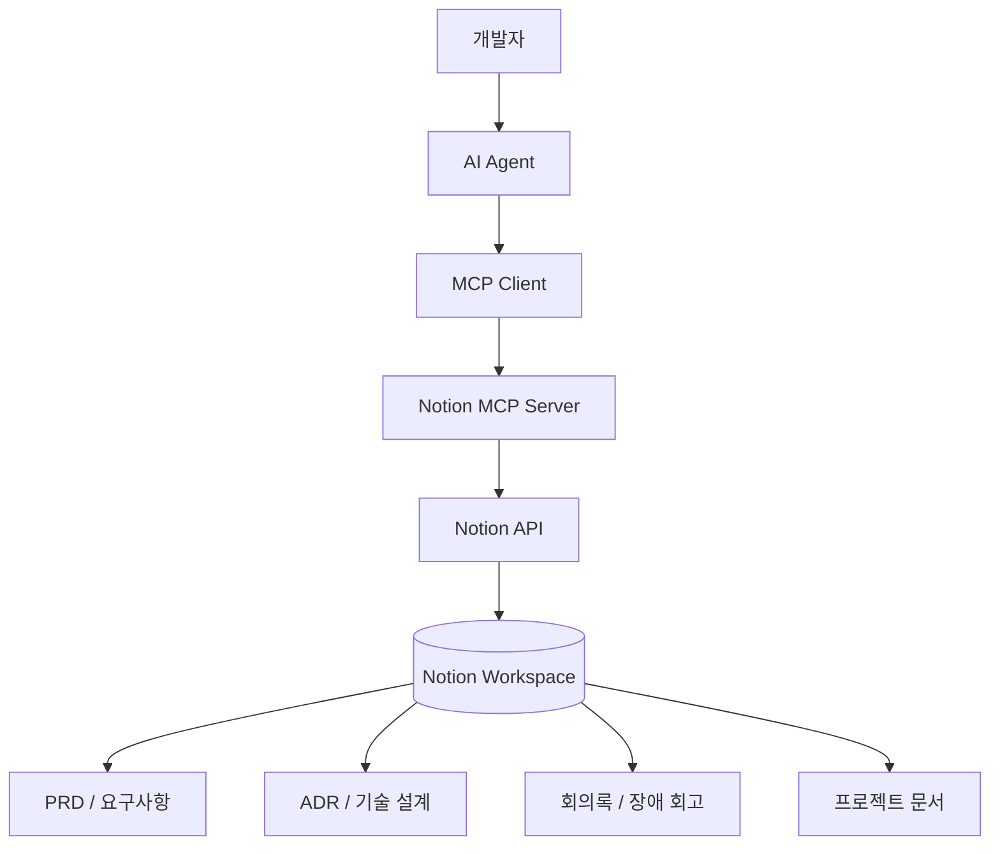
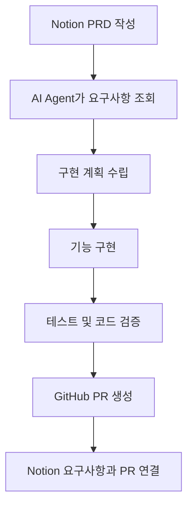
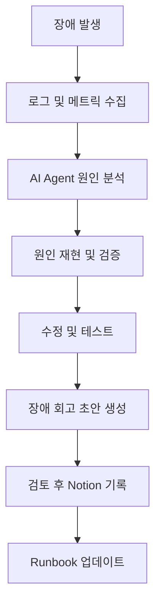
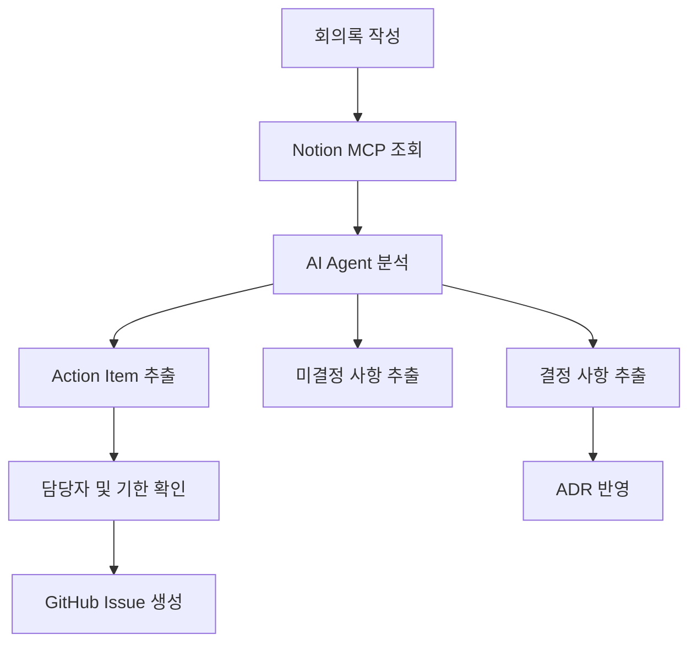
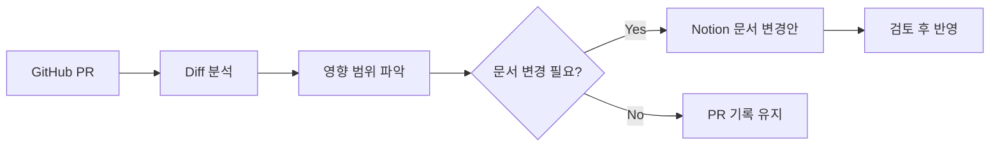
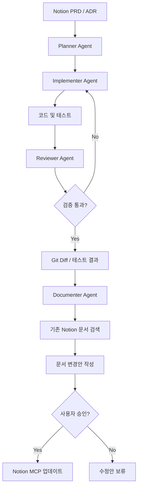
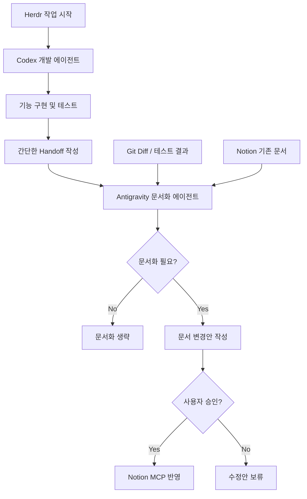

# Notion MCP

---

## 📄 본문

### Notion MCP란?

**Notion MCP(Model Context Protocol)** 는 AI 에이전트가 Notion 워크스페이스의 페이지, 데이터베이스 및 블록에 접근하여 정보를 조회하거나 수정할 수 있도록 연결하는 인터페이스이다.

기존에는 개발자가 직접 Notion을 열어 문서를 검색하고 작성해야 했지만, MCP를 활용하면 AI 에이전트가 개발 과정에서 필요한 문서를 읽고, 분석하고, 갱신할 수 있다.

대표적인 활용 사례는 다음과 같다.

- 기존 프로젝트 요구사항(PRD) 조회
- 기술 설계 및 아키텍처 문서 검색
- 개발 결과와 기존 문서 비교
- API 변경 사항 문서화
- ADR(Architecture Decision Record) 작성
- 장애 분석 및 회고 기록
- 회의록 분석 및 액션 아이템 추출
- 신규 개발자 온보딩 지원

**핵심은 AI를 단순한 문서 작성 도구가 아니라, 개발 과정에서 발생한 정보를 팀의 지식으로 축적하는 에이전트로 활용하는 것이다.**

### Notion MCP의 동작 구조



| 구성 요소 | 역할 |
|---|---|
| AI Agent | 사용자 요청 해석 및 도구 호출 판단 |
| MCP Client | MCP 서버와 통신 |
| Notion MCP Server | Notion 기능을 MCP 도구로 제공 |
| Notion API | 실제 Notion 데이터 접근 |
| Notion Workspace | 페이지 및 데이터베이스 저장소 |
| OAuth | 사용자 인증 및 접근 권한 승인 |

AI 에이전트는 자연어 요청을 해석한 후 필요한 MCP 도구를 선택하여 실행한다.

예를 들어 사용자가 "현재 프로젝트의 인증 구조를 Notion에 정리해줘"라고 요청하면, 에이전트는 기존 Notion 문서를 검색하고 실제 프로젝트 코드를 분석한 후 문서 생성 또는 수정 도구를 호출할 수 있다.

단, 접근 가능한 데이터와 수행 가능한 작업은 사용자의 Notion 권한 및 MCP 서버가 제공하는 기능에 따라 달라진다.

### Antigravity CLI와 Notion MCP 연결

2026년 11월 기준 실습 환경은 다음과 같다.

| 항목 | 환경 |
|---|---|
| OS | macOS |
| AI CLI | Antigravity CLI (`agy`) |
| MCP 서버 | Notion 공식 Remote MCP |
| 인증 | OAuth |
| 연결 대상 | 개인 Notion 워크스페이스 |

#### 1. MCP 서버 등록

Antigravity CLI의 전역 MCP 설정 파일을 사용한다.

```bash
~/.gemini/config/mcp_config.json
```

설정 예시:

```json
{
  "mcpServers": {
    "notion": {
      "serverUrl": "https://mcp.notion.com/mcp"
    }
  }
}
```

기존 MCP 서버가 있다면 `mcpServers` 객체 내부에 `notion` 항목만 추가한다.

프로젝트별로 설정을 관리할 수도 있지만, 여러 프로젝트에서 동일한 Notion 워크스페이스를 활용하려면 전역 설정이 편리하다.

#### 2. Antigravity CLI 실행

```bash
agy
```

CLI 내부에서 MCP 관리 메뉴를 실행한다.

```text
/mcp
```

등록된 MCP 서버 목록에서 `notion`을 확인한다.

#### 3. OAuth 인증

최초 연결 과정에서 다음 오류가 발생하였다.

```text
MCP Servers

Plugins (~/.gemini/config/plugins)
> ✗ notion error: calling "initialize":
  sending "initialize": Unauthorized
[Auth Needed]
```

**원인**

Notion MCP 서버에 대한 연결 시도는 이루어졌지만, OAuth 인증이 완료되지 않아 초기화 요청이 거부된 상태이다.

| 메시지 | 의미 |
|---|---|
| `initialize` | MCP 초기 연결 과정 |
| `Unauthorized` | 인증되지 않은 요청 |
| `Auth Needed` | 사용자 인증 필요 |
| `Plugins` | 플러그인 설정을 통해 로드된 서버 |

**해결 과정**

1. `agy` 실행
2. `/mcp` 명령어 실행
3. Notion 서버 선택
4. `Authenticate` 메뉴 선택
5. 브라우저에서 Notion 로그인
6. 워크스페이스 접근 권한 승인
7. CLI로 돌아와 인증 상태 확인

실습에서는 위 인증 과정을 거쳐 정상적으로 연결하였다.

**주의:** `Unauthorized`가 발생했다고 무조건 MCP 설정 파일을 삭제하거나 API 토큰을 재발급할 필요는 없다. 우선 OAuth 인증 상태를 확인한다.

### Notion MCP에서 활용하는 주요 기능

| 기능 | 설명 | 활용 사례 |
|---|---|---|
| Search | 페이지 및 데이터베이스 검색 | 기존 프로젝트 문서 탐색 |
| Retrieve | 페이지 정보 조회 | 요구사항 확인 |
| Block Read | 페이지 내부 블록 조회 | 문서 내용 분석 |
| Create | 페이지 또는 블록 생성 | 신규 학습 문서 작성 |
| Update | 기존 데이터 수정 | 설계 변경 사항 반영 |
| Append | 기존 페이지에 블록 추가 | 작업 이력 추가 |
| Database Query | 지원되는 데이터 소스 조회 | 프로젝트 작업 관리 |

실제 사용 가능한 도구의 명칭과 범위는 MCP 서버 버전 및 권한에 따라 달라질 수 있다.

---

### 백엔드 개발 실무에서의 활용

Notion MCP의 활용 가치는 **개발 과정에서 발생하는 기술적 의사결정과 변경 사항을 팀의 지식으로 축적하는 것**에 있다.

기존 실무에서도 PRD, ADR, 장애 회고, API 문서, 회의록 등을 관리한다. Notion MCP는 이러한 문서 관리 과정을 AI 에이전트와 연결하여 자동화할 수 있게 한다.

다만 AI 기반 문서 자동화가 모든 개발 조직에서 표준화된 것은 아니다. 아래 내용은 기존 개발 문서 관리 관행과 MCP를 결합한 실무 적용 패턴이다.

### 1. PRD 기반 개발 및 요구사항 추적

PRD(Product Requirements Document)는 제품 또는 기능의 요구사항을 정의한 문서이다.

일반적인 개발 과정에서는 개발자가 PRD를 읽고 기능을 구현한다.

MCP를 활용하면 AI 에이전트가 직접 Notion의 PRD를 조회하고, 해당 내용을 개발 계획에 반영할 수 있다.

**활용 흐름**



**활용 예시**

수강 신청 시스템에 다음 요구사항이 존재한다고 가정한다.

- 강의 정원 초과 방지
- 수강 신청 동시성 보장
- 신청 취소 시 정원 복구
- 강의 모집 상태 검증

AI 에이전트는 Notion에서 요구사항을 조회하고 실제 코드와 비교하여 미구현 항목을 확인할 수 있다.

**실무적 가치**

- 요구사항 누락 방지
- 구현 결과와 요구사항 비교
- 변경된 요구사항 추적
- PR과 기획 문서 연결

### 2. ADR 자동 작성 및 관리

ADR(Architecture Decision Record)은 아키텍처나 기술 선택에 대한 의사결정을 기록하는 문서이다.

중요한 것은 **어떤 기술을 사용했는가보다 왜 해당 기술을 선택했는가**이다.

예를 들어 RabbitMQ를 도입했다면 도입 배경, 고려한 대안, 장단점, 트레이드오프를 기록한다.

**ADR 예시**

```markdown
# ADR-004: AI 견적 생성 비동기 처리

## 상태
Accepted

## 배경
AI 견적 생성 시간이 길어 사용자 대기와
후속 데이터 저장 누락 위험이 존재한다.

## 결정
RabbitMQ를 활용하여 사고 레포트 저장과
AI 견적 생성을 분리한다.

## 고려한 대안
- 동기 HTTP 요청
- Spring @Async
- RabbitMQ

## 선택 이유
- 비동기 작업 분리
- 재시도 및 실패 처리 구조
- 서비스 간 결합도 감소

## 트레이드오프
- 메시지 중복 처리 필요
- DLQ 및 재시도 정책 관리
- 메시징 인프라 운영 비용 증가

## 관련 자료
- GitHub PR
- 아키텍처 다이어그램
- 테스트 결과
```

MCP를 사용하면 에이전트가 기존 ADR을 검색하고, 새롭게 결정된 기술 사항을 기록하거나 관련 문서를 갱신할 수 있다.

**ADR을 남기기 좋은 경우**

- 데이터베이스 선택 및 변경
- 메시지 큐 도입
- 인증 및 인가 구조 변경
- 동시성 제어 전략 선택
- 캐싱 전략 변경
- 서비스 간 통신 방식 변경
- 아키텍처 및 도메인 경계 변경

모든 코드 수정에 ADR을 생성할 필요는 없다.

### 3. 장애 분석 및 회고 자동화

장애 발생 시 로그, 설정, 코드 변경 사항을 분석하고 결과를 Notion에 기록하는 방식이다.

**활용 흐름**



**장애 회고 문서 구성**

| 항목 | 내용 |
|---|---|
| 장애 개요 | 어떤 문제가 발생했는가 |
| 발생 시각 | 장애 시작 및 종료 시점 |
| 영향 범위 | 사용자 및 시스템 영향 |
| 탐지 방법 | 로그, 알림, 모니터링 |
| 근본 원인 | 검증된 장애 원인 |
| 대응 과정 | 조치 순서 및 결과 |
| 재발 방지 | 개선 사항 및 후속 작업 |
| 관련 자료 | 로그, PR, 모니터링 링크 |

예를 들어 RabbitMQ의 `Failed to declare queue` 오류가 발생하면 에이전트가 관련 로그와 설정을 분석한다.

원인이 확인되고 수정이 검증된 이후 Notion에 장애 회고를 기록한다.

**주의:** AI가 제시한 추정 원인과 실제 검증된 원인을 구분해야 한다.

### 4. API 및 데이터베이스 변경 문서화

백엔드 개발에서는 API 계약이나 DB 스키마 변경이 다른 개발자와 서비스에 영향을 줄 수 있다.

MCP를 활용하면 코드 변경 사항을 분석하고 기존 문서와 비교하여 문서 변경안을 작성할 수 있다.

| 비교 대상 | 확인 사항 |
|---|---|
| Git Diff | 변경된 코드 |
| OpenAPI | 요청 및 응답 계약 |
| Flyway | DB 스키마 변경 |
| Notion | 기존 설계 및 비즈니스 규칙 |
| GitHub PR | 변경 목적과 리뷰 결과 |

예를 들어 `Enrollment`에 새로운 상태가 추가되었다면 다음 내용을 확인한다.

1. 엔티티 상태 변경
2. 상태 전이 규칙 변경
3. API 응답 변경 여부
4. 기존 문서와의 차이
5. 영향받는 서비스 및 테스트

이후 필요한 Notion 문서만 수정한다.

**중요:** API의 정확한 계약은 OpenAPI, 스키마 변경 이력은 Flyway와 같은 코드 기반 산출물을 기준으로 관리한다. Notion은 설계 의도와 변경 이유를 설명하는 역할로 활용한다.

### 5. 회의록 및 액션 아이템 관리

회의록을 AI가 분석하여 결정 사항과 후속 작업을 구분하는 방식이다.

**활용 흐름**



예를 들어 동시성 제어 관련 회의에서 다음 내용을 논의했다고 가정한다.

- 비관적 락과 원자적 UPDATE 비교
- 마지막 자리 동시 신청 처리
- PENDING 상태의 만료 정책
- 정원 복구 정책

AI는 이를 분석하여 다음과 같이 분류할 수 있다.

**결정 사항**

- 회의에서 확정한 기술 선택

**미결정 사항**

- 추가 검증이 필요한 기술 및 정책

**액션 아이템**

- 동시성 테스트 구현
- 부하 테스트 진행
- DB 락 전략 비교

GitHub MCP까지 연결하면 확인된 액션 아이템을 Issue로 생성하는 자동화도 구성할 수 있다.

단, 회의에서 확정되지 않은 사항을 AI가 임의로 결정해서는 안 된다.

### 6. 신규 개발자 온보딩

신규 개발자가 프로젝트에 참여할 때 기존 문서와 코드베이스를 기반으로 질문에 답하는 방식이다.

**활용 예시**

> 현재 프로젝트의 인증 구조를 설명해줘. Notion 설계 문서와 실제 Spring Security 코드를 비교해서 설명하고, 차이가 있다면 알려줘.

> 프로젝트에서 RabbitMQ를 도입한 이유를 기존 ADR에서 찾아줘.

> 로컬 개발환경 실행 방법과 필요한 환경변수를 기존 문서를 기반으로 정리해줘.

이러한 방식은 신규 개발자가 여러 문서를 직접 탐색하는 부담을 줄여준다.

다만 Notion 문서가 최신 상태라는 보장은 없으므로 실제 코드와 비교하는 과정이 중요하다.

### 7. PR 리뷰 및 변경 이력 관리

GitHub MCP와 Notion MCP를 함께 활용하는 방식이다.

**활용 흐름**



모든 PR에 새로운 Notion 페이지를 생성하는 것은 권장하지 않는다.

사소한 버그 수정이나 내부 리팩터링은 PR과 커밋 이력만으로 충분할 수 있다.

반면 API 계약, 아키텍처, 비즈니스 규칙 등이 변경되었다면 기존 Notion 문서를 갱신할 가치가 있다.

---

### Herdr 멀티 에이전트와 Notion MCP 활용

Herdr를 활용하여 개발 에이전트와 문서화 에이전트를 분리할 수 있다.

**핵심은 에이전트마다 역할과 권한을 분리하는 것이다.**

| 에이전트 | 역할 | Notion 접근 |
|---|---|---|
| Planner | 요구사항 분석 및 구현 계획 | 읽기 |
| Implementer | 코드 구현 및 테스트 작성 | 불필요 |
| Reviewer | 코드 및 테스트 검증 | 필요 시 읽기 |
| Documenter | 변경 내용 분석 및 문서화 | 읽기·쓰기 |

#### 권장 워크플로



#### 에이전트 간 전달해야 하는 정보

개발 에이전트가 문서화 에이전트에게 전체 대화 내용을 그대로 전달하는 것보다, 검증 가능한 산출물을 전달하는 방식이 좋다.

- Git Diff
- 변경 파일 목록
- 테스트 실행 결과
- 커밋 SHA
- PR URL
- 기술 선택의 이유
- 관련 Notion 문서 URL
- 알려진 제약 및 미해결 문제

이러한 정보가 있어야 문서화 에이전트가 실제 구현 내용에 근거하여 문서를 작성할 수 있다.

#### 문서화 필요 여부 판단

| 변경 유형 | 문서화 정책 |
|---|---|
| 아키텍처 변경 | ADR 작성 또는 갱신 |
| 새로운 기술 도입 | 기술 선택 근거 기록 |
| API 계약 변경 | API 관련 문서 갱신 |
| DB 스키마 변경 | 관련 설계 문서 갱신 |
| 중요 장애 수정 | 장애 회고 작성 |
| 비즈니스 규칙 변경 | 도메인 문서 갱신 |
| 내부 리팩터링 | 필요 시 기존 문서 수정 |
| 사소한 수정 | PR 및 커밋 기록으로 관리 |

**Documenter Agent는 매 작업마다 변경 사항을 검사할 수 있지만, Notion에 실제로 기록하는 것은 조건부로 수행하는 방식이 효율적이다.**

#### 권장 프롬프트

```text
현재 프로젝트의 개발 결과를 분석하고
문서화가 필요한 변경 사항을 판단해줘.

1. Git Diff와 변경 파일을 확인한다.
2. 테스트 결과와 구현 상태를 확인한다.
3. Notion에서 관련 문서를 검색한다.
4. 기존 문서와 실제 구현 내용을 비교한다.
5. ADR, API, 도메인, 운영 문서의 변경 필요성을 판단한다.
6. 문서 변경안을 작성한다.
7. 사용자 승인 후 Notion에 반영한다.

규칙:
- 실제 코드와 테스트 결과를 근거로 작성한다.
- 기존 문서를 우선 갱신하고 중복 생성을 피한다.
- 검증되지 않은 내용을 사실처럼 기록하지 않는다.
- 사소한 수정은 별도 문서를 생성하지 않는다.
- 승인 없이 기존 문서를 삭제하거나 덮어쓰지 않는다.
```

#### 확장 가능한 개발 파이프라인

```text
Notion PRD
    ↓
Herdr / Planner
    ↓
Herdr / Implementer
    ↓
Herdr / Reviewer
    ↓
GitHub PR
    ↓
Herdr / Documenter
    ↓
Notion ADR / 기술 문서
```

이 구조는 Herdr의 실제 에이전트 실행·결과 전달 방식에 맞춰 오케스트레이션을 구현해야 하며, 단순히 역할을 프롬프트에 적는 것만으로 자동 파이프라인이 완성되는 것은 아니다.

---

### 실무에서 정보의 기준 관리

Notion을 모든 정보의 저장소로 사용하는 것은 바람직하지 않다.

각 도구의 역할을 구분하는 것이 중요하다.

| 도구 | 관리 대상 |
|---|---|
| GitHub | 코드, 커밋, PR, 리뷰 |
| Notion | PRD, ADR, 회의록, 운영 지식 |
| OpenAPI | API 계약 |
| Flyway | DB 마이그레이션 |
| CI/CD | 빌드 및 테스트 결과 |
| 모니터링 도구 | 로그, 메트릭, 트레이스 |

**Notion은 개발 지식과 의사결정을 축적하는 공간이고, 코드 및 실행 가능한 명세는 해당 저장소를 사실의 기준으로 유지한다.**

### Notion MCP 사용 시 주의사항

1. **최소 권한 원칙:** 에이전트가 필요한 페이지와 작업에만 접근하도록 제한한다.
2. **쓰기 작업 승인:** 중요한 문서의 수정·삭제는 사용자 검토 후 실행한다.
3. **기존 문서 우선:** 중복 페이지 생성보다 기존 문서 갱신을 우선한다.
4. **검증 가능한 근거:** 코드, 테스트, PR 등 실제 산출물을 기반으로 문서화한다.
5. **민감정보 보호:** 비밀번호, API 키, 개인정보, 내부 보안 정보를 불필요하게 문서화하지 않는다.
6. **문서 최신성:** 기존 문서가 항상 정확하다고 가정하지 않는다.
7. **도구 호출 범위:** MCP가 접근할 수 없는 자료를 조회했다고 가정하지 않는다.

---

### Notion MCP 실습

#### 실습 환경

- macOS
- Antigravity CLI
- Notion 공식 MCP 서버
- OAuth 인증 완료
- 기존 Notion 워크스페이스 활용

#### 실습 1. MCP 연결 및 인증

**목표:** Antigravity CLI에서 Notion MCP 서버 연결

진행 내용:

1. Notion MCP 서버 설정
2. `agy` 실행
3. `/mcp` 메뉴 확인
4. `Unauthorized` 오류 확인
5. `Authenticate` 메뉴를 통한 OAuth 인증
6. 연결 성공 확인

**결과:** Notion MCP 연결 및 인증 성공.

#### 실습 2. 사용 가능한 도구 확인

**목표:** Notion MCP가 제공하는 기능 파악

```text
현재 연결된 Notion MCP에서 사용 가능한 도구를
확인하고 검색, 조회, 생성, 수정, 데이터베이스
작업으로 분류해줘.

실제 도구 목록을 기준으로 설명하고
Notion 데이터는 변경하지 마.
```

확인할 내용:

- MCP Tool Discovery
- 도구 이름 및 역할
- 읽기·쓰기 기능 구분

#### 실습 3. 기존 페이지 탐색

**목표:** Notion 워크스페이스 검색

```text
내 Notion 워크스페이스에서 접근 가능한
페이지와 데이터베이스를 검색해줘.

제목, 유형, 상위 페이지, URL을 정리하고
개발 및 학습 관련 페이지를 분류해줘.

읽기 전용으로 진행해.
```

확인할 내용:

- 검색 가능한 페이지 범위
- 페이지와 데이터베이스 구분
- 접근 권한
- 검색 결과의 페이지네이션

#### 실습 4. 기존 문서 분석

**목표:** Notion 페이지 내부 내용 읽기

```text
내 Notion에서 Spring 관련 페이지를 검색해줘.

관련성이 높은 최대 5개의 문서를 읽고
핵심 내용을 요약해줘.

각 문서의 부족한 부분과
추가 학습이 필요한 주제를 정리해줘.

문서는 수정하지 마.
```

확인할 내용:

- 페이지 블록 조회
- 하위 블록 탐색
- 문서 내용 요약
- 출처 페이지 확인

#### 실습 5. 여러 문서 통합 분석

**목표:** 복수 페이지를 참조한 종합 분석

```text
내 Notion에서 Git, Docker, Spring Boot 관련
문서를 찾아줘.

각 주제별 문서를 비교하고
백엔드 개발자 학습 관점에서
잘 정리된 내용과 부족한 내용을 분석해줘.

참고한 페이지 링크를 제공해줘.
```

확인할 내용:

- 여러 페이지 검색
- 문서 간 내용 비교
- 중복 및 누락 분석
- 근거 문서 연결

#### 실습 6. 기존 페이지 수정

**목표:** 기존 문서에 새로운 내용 추가

```text
내 Notion에서 MCP 실습 페이지를 검색해줘.

기존 내용을 확인한 뒤
Notion MCP 활용 예시 섹션을 추가할
변경안을 작성해줘.

내가 승인하기 전에는
실제 문서를 수정하지 마.
```

확인할 내용:

- 기존 문서 검색
- 블록 추가
- 변경 전후 비교
- 사용자 승인

#### 실습 7. 새로운 페이지 생성

**목표:** AI를 활용한 Notion 문서 자동 생성

```text
내 Notion에서 MCP 실습이라는
페이지가 존재하는지 검색해줘.

중복 페이지가 없다면
내가 지정할 상위 페이지 아래에
새로운 학습 문서를 생성할 준비를 해줘.

MCP 개념, 연결 구조, 인증 방식,
실습 내용, 주의사항을 포함해줘.

생성 전 내용을 먼저 보여줘.
```

확인할 내용:

- 페이지 중복 검사
- 상위 페이지 지정
- 신규 페이지 생성
- Markdown 및 Notion 블록 구조

#### 실습 8. 로컬 프로젝트와 Notion 연계

**목표:** 실제 코드 분석 결과를 Notion에 반영

```text
현재 Spring Boot 프로젝트를 분석해줘.

README.md, build.gradle,
src/main 디렉터리를 확인하고
기술 스택과 주요 도메인을 정리해줘.

Notion에서 관련 프로젝트 문서를 검색하고
실제 코드와 기존 문서의 차이를 비교해줘.

문서 변경안을 작성하되
내 승인 전에는 수정하지 마.
```

확인할 내용:

- 로컬 파일 분석
- Notion MCP 연계
- 코드와 문서 비교
- 변경 사항 추적

#### 실습 9. Herdr 멀티 에이전트 문서화

**목표:** 개발·검증·문서화 에이전트 분리

```text
Herdr를 활용하여 현재 프로젝트의
개발 작업을 역할별로 분리해줘.

Planner:
기존 Notion 문서와 요구사항 분석

Implementer:
코드 구현 및 테스트 작성

Reviewer:
Git Diff와 테스트 결과 검증

Documenter:
검증된 결과를 바탕으로
Notion 문서 변경안 작성

모든 검증이 끝난 후
문서화가 필요한 변경 사항만 선별하고
사용자 승인 후 Notion에 반영해줘.
```

확인할 내용:

- 에이전트 역할 분리
- 에이전트 간 산출물 전달
- 검증 결과 기반 문서화
- 문서화 조건 판단
- Notion 쓰기 작업 승인

**실습 진행 상태**

- [x] Notion MCP 서버 등록
- [x] OAuth 인증 문제 해결
- [x] Notion MCP 연결 성공
- [ ] MCP 도구 탐색
- [ ] 기존 페이지 검색
- [ ] 페이지 내용 분석
- [ ] 복수 문서 통합 분석
- [ ] 기존 페이지 수정
- [ ] 신규 페이지 생성
- [ ] 로컬 프로젝트 연계
- [ ] Herdr 멀티 에이전트 연계

### Codex 토큰 절약을 위한 Notion MCP 문서화 전략

#### 목적

Herdr를 활용한 멀티 에이전트 개발 환경에서 **Codex의 토큰 소비를 최소화하면서 Notion 문서의 품질을 유지하는 것**이 목적이다.

이를 위해 개발과 문서화 역할을 분리한다.

- **Codex:** 코드 구현, 테스트, 핵심 설계 의도 전달
- **Antigravity CLI(agy):** 개발 결과 분석, 문서 작성, Notion MCP 연동
- **Herdr:** 에이전트 실행 및 작업 흐름 조율
- **Notion MCP:** 기존 문서 조회 및 최종 문서 반영

핵심 전략은 **Codex가 완성된 문서를 작성하지 않고, 최소한의 인수인계 정보만 전달하는 것**이다.

#### 문서화 방식 비교

| 방식 | Codex 토큰 소비 | 문서 품질 | 평가 |
|---|---|---|---|
| Codex → Notion MCP 직접 작성 | 높음 | 높음 | Codex 사용량 집중 |
| Codex → 완성 문서 → agy 등록 | 중~높음 | 높음 | 문서 작성 작업 중복 가능 |
| **Codex → 간단한 Handoff → agy 문서화** | **낮음** | **높음(검증 시)** | **권장** |
| Codex → 코드만 작성 → agy가 Diff 분석 | 가장 낮음 | 중~높음 | 설계 의도 누락 위험 |

※ 토큰 소비와 문서 품질은 작업 범위에 따른 상대적 예상이며, 실제 측정 결과는 아니다.

#### 권장 워크플로



**진행 순서**

1. Codex가 기능 구현 및 테스트를 수행한다.
2. 작업 완료 후 핵심 설계 의도와 검증 결과를 간단한 Handoff 파일로 작성한다.
3. Herdr가 작업 완료 상태를 확인하고 agy 문서화 에이전트에 작업을 전달한다.
4. agy가 Handoff, Git Diff, 테스트 결과를 확인한다.
5. Notion MCP를 통해 기존 관련 문서를 검색한다.
6. 문서화 필요 여부를 판단하고 변경안을 작성한다.
7. 사용자 승인 후 기존 Notion 문서를 갱신하거나 신규 문서를 생성한다.

#### Codex Handoff 작성 규칙

Codex가 상세한 기술 문서를 작성하면 문서 구성과 내용 생성에 토큰이 추가로 소비된다.

따라서 **10~20줄 내외의 구조화된 Handoff**만 작성하도록 한다.

특히 다음 세 가지를 우선 전달한다.

| 항목 | 설명 |
|---|---|
| Why | 해당 구현 방식을 선택한 이유 |
| Trade-off | 고려한 대안 및 포기한 요소 |
| Caveat | 남아 있는 제약, 위험, 미해결 문제 |

Git Diff로 확인 가능한 변경 사항은 반복해서 설명하지 않는다.

**Handoff 예시**

```markdown
# Development Handoff

## 작업
수강 신청 정원 초과 방지

## 변경 사항
- 원자적 UPDATE 적용
- 동시성 통합 테스트 추가

## 결정 이유
- DB 수준에서 정원 초과 방지
- 조건부 UPDATE로 정합성 확보

## 트레이드오프
- 갱신 실패 시 비즈니스 예외 처리 필요

## 검증
- 동시 요청 테스트 통과

## 관련 파일
- CourseRepository.java
- EnrollmentService.java
- EnrollmentConcurrencyTest.java

## 문서화 필요
- 동시성 제어 ADR
- 수강 신청 도메인 규칙
```

실제 운영 시 Handoff는 다음과 같이 작업별로 관리할 수 있다.

```text
docs/
└── handoffs/
    ├── issue-10.md
    ├── issue-16.md
    └── issue-23.md
```

임시 산출물이라면 Git 추적 대상에서 제외하고, 영구적인 기록이 필요한 내용은 Notion이나 ADR에 남기는 방식을 고려한다.

#### Antigravity 문서화 에이전트 역할

agy는 다음 세 가지 자료를 결합하여 문서의 정확성과 품질을 확보한다.

| 자료 | 역할 |
|---|---|
| Codex Handoff | 설계 의도 및 기술적 판단 근거 |
| Git Diff + 테스트 결과 | 실제 구현 및 검증된 사실 |
| Notion 기존 문서 | 요구사항, 기존 설계, 관련 기술 기록 |

**문서화 에이전트의 작업 규칙**

- 기존 Notion 문서를 먼저 검색한다.
- 변경된 파일과 관련 코드만 분석한다.
- Handoff 내용이 실제 구현과 일치하는지 확인한다.
- ADR, API, 도메인, 운영 문서 중 필요한 문서만 갱신한다.
- 기존 문서와 중복되는 신규 페이지를 생성하지 않는다.
- 구현되지 않은 기능을 완료했다고 기록하지 않는다.
- 사용자 승인 전에는 Notion을 수정하지 않는다.

#### 토큰 소비 최적화 전략

| 최적화 방법 | 기대 효과 |
|---|---|
| Codex의 Notion MCP 호출 생략 | 도구 호출 및 응답 컨텍스트 감소 |
| 짧은 Handoff 작성 | Codex 문서 생성 토큰 절약 |
| Git Diff 기반 전달 | 전체 대화 기록 전달 방지 |
| 변경 파일 중심 분석 | agy의 불필요한 코드 탐색 감소 |
| 기존 Notion URL 활용 | 중복 문서 검색 최소화 |
| 문서화 필요 여부 판단 | 불필요한 문서 생성 방지 |
| 검증된 커밋 기준 문서화 | 변경 중인 코드로 인한 불일치 방지 |

**주의할 점**

Codex의 토큰 소비가 감소한다고 전체 AI 시스템의 토큰 소비까지 반드시 감소하는 것은 아니다. 문서화 작업이 agy로 이동하기 때문이다.

또한 컨텍스트 사용량과 계정의 실제 사용 한도는 다른 개념이다. 토큰 절감 효과는 작업별 사용량을 비교하여 판단해야 한다.

#### Herdr 자동화 시 고려 사항

- Codex와 agy의 역할을 명확히 분리한다.
- Codex의 개발 및 검증이 완료된 후 문서화를 시작한다.
- 동일한 작업 디렉터리의 동시 수정은 피한다.
- 문서화는 확정된 Git Diff 또는 커밋을 기준으로 수행한다.
- Handoff 파일에 민감정보를 기록하지 않는다.
- Notion 수정은 승인 절차를 거친다.
- 사소한 코드 변경은 문서화를 생략할 수 있도록 한다.

#### 향후 실습 계획

- [ ] Codex 전용 Handoff 템플릿 작성
- [ ] agy 문서화 전담 에이전트 지침 작성
- [ ] Herdr를 이용한 에이전트 간 작업 전달
- [ ] Git Diff 및 테스트 결과 기반 문서 작성
- [ ] Notion MCP를 통한 기존 ADR 갱신
- [ ] 신규 ADR 자동 생성 실습
- [ ] 문서화 필요 여부 자동 판단
- [ ] Codex 직접 문서화와 역할 분리 방식의 토큰 사용량 비교

**최종 목표**

`Codex 구현 → 테스트 검증 → 최소 Handoff → agy 문서화 → Notion MCP 반영`

Codex는 개발에 집중하고, Antigravity는 문서화에 집중하도록 역할을 분리하여 **Codex 토큰 사용량을 줄이면서도 검증 가능한 고품질 기술 문서를 유지하는 개발 워크플로**를 구축한다.

---

## ✏️ 메모

### 학습하면서 기억할 점

- MCP는 AI 모델 자체의 기능이 아니라 외부 도구와 데이터를 연결하는 프로토콜이다.
- Notion MCP는 문서 검색과 작성뿐 아니라 개발 워크플로의 지식 관리에도 활용할 수 있다.
- 개발 에이전트와 문서화 에이전트를 분리하면 역할과 권한을 명확히 관리할 수 있다.
- 모든 코드 변경을 Notion에 기록할 필요는 없다.
- ADR은 기술 선택의 결과뿐 아니라 선택한 이유와 대안을 기록한다.
- GitHub와 Notion을 함께 활용하면 코드 변경 이력과 기술 의사결정을 연결할 수 있다.
- AI가 작성한 문서는 실제 코드 및 테스트 결과와 일치하는지 검증해야 한다.

### 추후 실습 아이디어

- GitHub PR Merge 이후 문서화 필요 여부 자동 판단
- RabbitMQ 장애 회고 문서 자동 생성
- Spring Boot API 변경 사항과 Notion 문서 비교
- 회의록에서 GitHub Issue 자동 생성
- 기존 ADR과 신규 설계 간 충돌 검사
- Notion PRD 기반 개발 작업 자동 생성
- Herdr의 Documenter Agent 전용 지침 작성
- CI 테스트 결과를 활용한 문서 변경안 생성

### 추가 학습 키워드

`MCP` · `OAuth` · `Tool Calling` · `Tool Discovery` · `ADR` · `PRD` · `Runbook` · `Postmortem` · `Agent Orchestration` · `Human-in-the-loop` · `Source of Truth`

---

## 📚 참고 및 링크

- [[]]

---

## 🔗 관련 노트

- [[../02 MOCs/AI|AI]]
